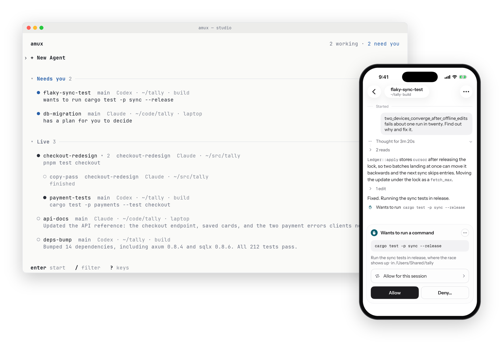
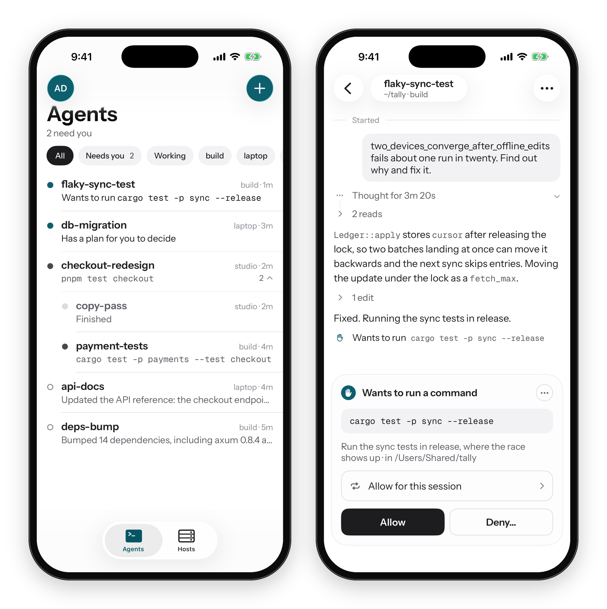
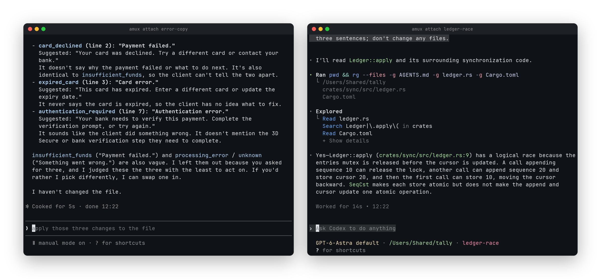
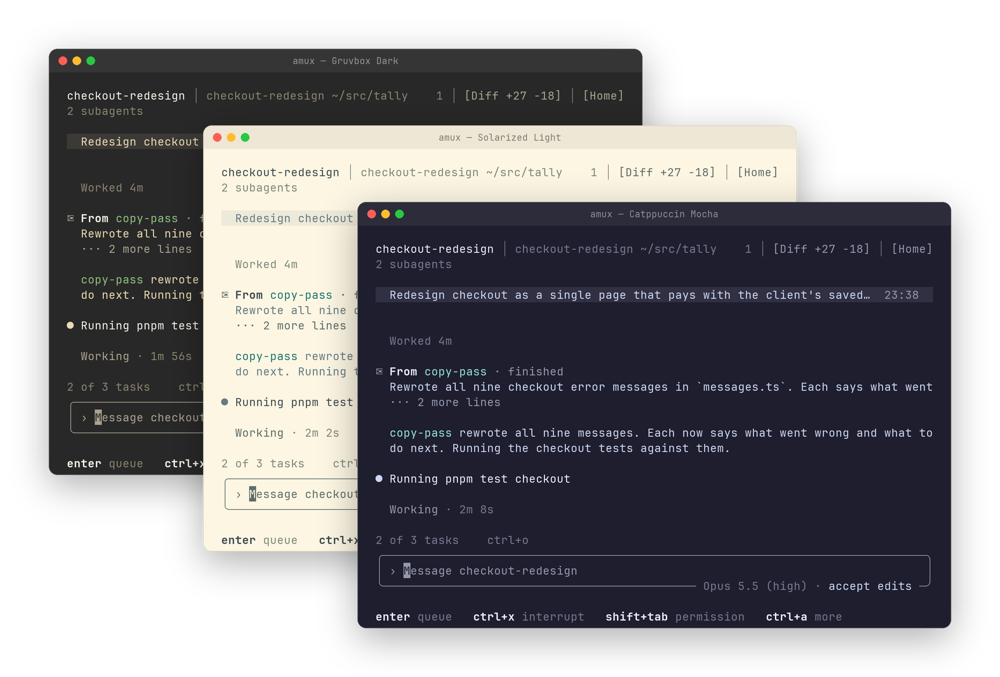
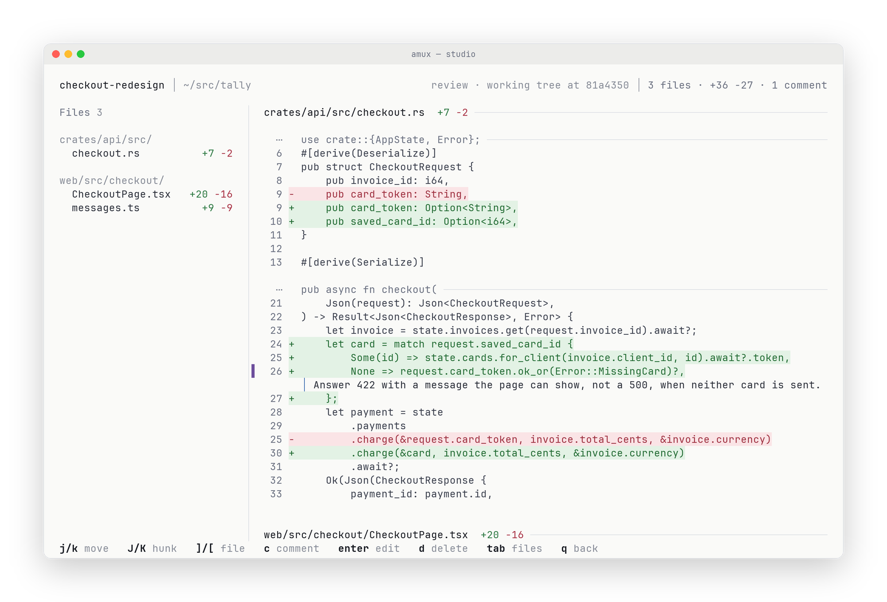
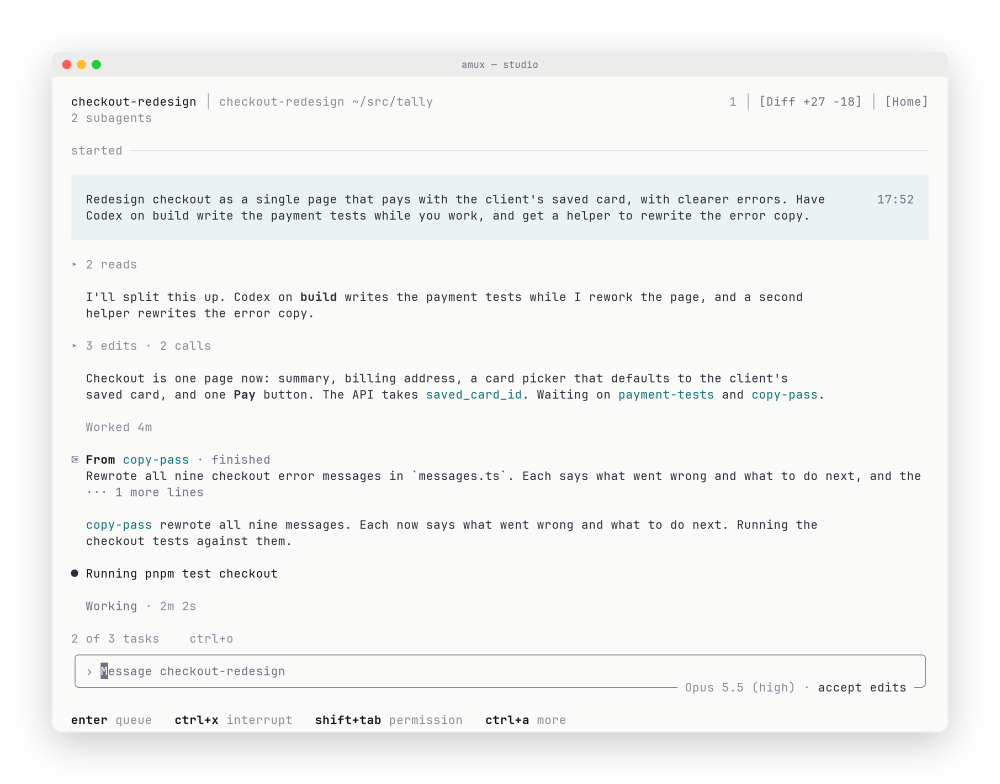
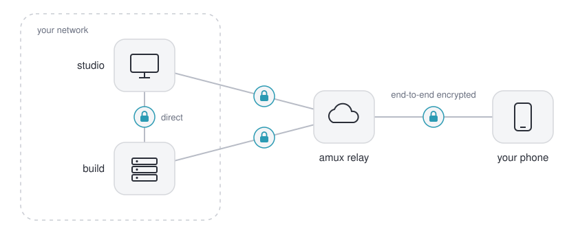

<p align="center">
  
</p>

<h1 align="center">amux</h1>

<p align="center">
  <strong>Your agents, everywhere, all at once.</strong>
</p>

<p align="center">
  amux brings every Claude Code and Codex agent on your computers into one place, in a
  beautiful terminal app and on your iPhone. See what each one is doing, answer the ones
  waiting on you, and let them hand work to each other, wherever you are.
</p>

```sh
curl -fsSL https://amux.sh/install | sh      # macOS, Linux
```

<p align="center">
  <a href="https://apps.apple.com/us/app/amux/id6760197635"></a>
</p>

<p align="center">
  <picture>
    <source media="(prefers-color-scheme: dark)" srcset="images/readme/hero-dark.png">
    
  </picture>
</p>

## Every agent, every machine, one list

Agents keep working on the machine you started them on: your desktop, a build server, your
laptop. amux shows all of them together, grouped by machine, with the agents that need you
at the top. Start a new agent on any of your machines, with any model, from the same place.

Agents carry on when amux restarts, updates or crashes, and every device catches up when it
comes back.

## Never leave an agent waiting

An agent that stops to ask for permission, present a plan or ask a question sits idle until
you answer. With amux every agent waiting on you is at the top of the list on your phone, and
you can approve the command, accept the plan or answer from wherever you are. The phone is a full
client, not a remote control: it shows the same agents and chats and can do everything the
terminal can, down to reading an agent's diff and commenting on its lines.

<p align="center">
  <picture>
    <source media="(prefers-color-scheme: dark)" srcset="images/readme/phone-dark.png">
    
  </picture>
</p>

## Their own interface, or one for both

Work in Claude Code's and Codex's own terminal interfaces, just as they are: `amux attach`
hands your terminal to the agent, and the same agent stays in your fleet and on your phone. Or
use amux's chat, which reads the same for Claude and Codex and takes its colours from your
terminal's theme.

<p align="center">
  
</p>

<p align="center">
  
</p>

## A terminal app worth living in

amux's own terminal app is fast, easy to use, and built to be looked at all day. The whole
fleet is one key away, and it comes with the tools you reach for between prompts:

- **Code review.** Read the agent's whole diff and comment on lines or files; the comments go
  back to the agent with your next message.
- **An overview** of what the agent has in flight: its tasks, background jobs, changed files
  and how close it is to its usage limits.
- **Attachments.** Paste a screenshot or a long log and the agent gets it whole.

<picture>
  <source media="(prefers-color-scheme: dark)" srcset="images/readme/review-dark.png">
  
</picture>

## Agents that work together

Every agent can see the others, message them and start subagents of its own, on any machine
you've paired. Claude can hand a task to Codex, and Codex to Claude: a Claude agent
redesigning checkout can start a Codex agent on your build server to write the payment tests
and another Claude to rewrite the error messages, and hears back from each one when it's done.

<picture>
  <source media="(prefers-color-scheme: dark)" srcset="images/readme/chat-dark.png">
  
</picture>

## Private by design

- **Your code stays on your machines.** Agents run where you started them; amux carries
  their chats between your devices.
- **End-to-end encrypted.** Every connection is encrypted between your own devices and
  checked against keys they exchanged when you paired them, whether it runs directly on your
  network or through the amux relay.
- **Trust you grant in person.** Machines trust each other only once you pair them, with a
  PIN or QR code on the screen in front of you. No account or server can grant access, and
  unpairing takes effect at once.

<p align="center">
  <picture>
    <source media="(prefers-color-scheme: dark)" srcset="images/readme/private-dark.svg">
    
  </picture>
</p>

[How amux works](docs/HOW_IT_WORKS.md) explains what each device, the account and the relay
can and cannot do.

## amux in 50 seconds

https://github.com/user-attachments/assets/714575f7-a9cb-497a-90ef-f12283c535a1

## Get started

```sh
curl -fsSL https://amux.sh/install | sh   # install
amux                                      # open the terminal app
amux pair --qr                            # pair your phone: scan the code with the camera
amux pair desk                            # or pair another computer found nearby
```

amux keeps itself up to date.

## Free, with an optional paid tier

amux is free. Your machines find each other on the same network, or connect over SSH, with
no account at all. The paid tier adds the amux relay, so you can reach your agents from
anywhere, securely, when your machines are apart.

## Supported

| | |
|---|---|
| **Agents** | Claude Code and Codex, in amux's chat or their own terminal interfaces |
| **Computers** | macOS, Linux |
| **Phone** | iPhone |

## Learn more

- [How amux works](docs/HOW_IT_WORKS.md): devices, accounts, pairing and the relay
- [The terminal app](docs/TERMINAL.md): screens, keys and commands
- [All documentation](docs/README.md)

## License

amux is source-available under the [Functional Source License](LICENSE) (FSL-1.1-ALv2):
free to read, build, modify and use for anything except competing with us, and Apache-2.0
two years after each version is published. [docs/LICENSING.md](docs/LICENSING.md) explains
it.
