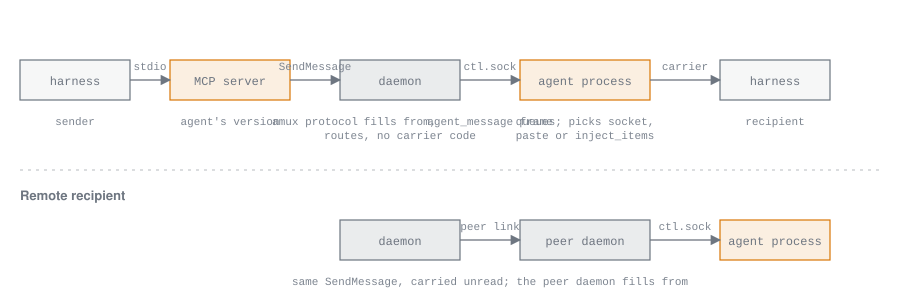

# Agent tools and messaging

*For developers changing the tools amux gives agents, how agents message each other, or how parent and child agents behave.*

Every agent, of every kind, gets the same seven tools from amux's MCP tool
server. With them an agent can list the fleet and its hosts, message another
agent, start a subagent of any kind on any paired host with the model,
effort, permission and workspace the work needs, stop its own subagents,
say what it is working on, and show a person a file it made. What
the tools read, the agent's daemon answers from what it holds; what they do
is addressed to the host that owns the agent it acts on, which sets every
message's sender and every child's parent from who called. No daemon has
kind-specific code for any of it: the recipient's own agent
process decides how a message reaches its provider.

The tool server is [`crates/agent/src/tools.rs`](../crates/agent/src/tools.rs).
The daemon's side is the services in
[`crates/node/src/api`](../crates/node/src/api), which take the caller from
the tools socket the call came in on, the sender and
attachments a message needs before it is handed over in
[`crates/node/src/relay.rs`](../crates/node/src/relay.rs), and the message
lanes and the parent outbox in the daemon core's
[`crates/daemon-core/src/deliveries.rs`](../crates/daemon-core/src/deliveries.rs). The
per-kind carriers are in the interpreters (`crates/interpret`) and in
`crates/agent/src/provider.rs`.

## The tool server

The harness starts the tool server itself, as `amux internal mcp <dir>` run from the
install path, so a process already started stays the version it started as,
and a server a provider starts later is whatever is at that path. The agent
process registers it when it launches the provider:
Claude gets it through `--mcp-config` as a server named `amux`, with every
tool but `attach_file` allowed by name in its settings (`mcp__amux__list_agents`
and so on) so they run without a permission prompt. `attach_file` goes through Claude's own
permission check like any read: it copies any file it is given into the blob
folder Claude may read without asking, so an unasked attach would read files
the person's own rules deny. In default mode it asks once per call; auto mode
applies its own check; bypass mode runs it. Codex gets it through
`--config mcp_servers.amux.command=…` and `mcp_servers.amux.args=…`, and when
Codex asks to approve a call to it, the interpreter approves at once, for the
session, without opening an ask; Codex's sandbox already reads any file. The server speaks MCP as
newline-delimited JSON-RPC on stdin and stdout.

Claude defers a tool server's tools behind its tool search, so a model knows
a deferred tool by its name alone until it searches. Four tools carry
Claude's `anthropic/alwaysLoad` metadata in their `_meta`, so Claude lists
them without a search: `start_subagent`, `message_agent`, `list_agents` and
`attach_file`. An agent that never loads `attach_file` writes a path in
prose, which a phone cannot open. The other three stay deferred:
`stop_subagent` is needed only after a start, when the agent has the tools
already; `set_working_on` has the conversation's title to fall back on; and
`list_hosts` is named in `start_subagent`'s description. Other providers
ignore the metadata. The names say what each tool reaches and does, since a
deferred tool is often known by its name alone.

Its identity is its agent's directory. The daemon listens on
`<dir>/tools.sock` for that agent alone, from the agent's start and again
from the moment a restarted daemon adopts the still-running agent, and the
tool server finds the socket
by its own directory, so the daemon knows which agent is calling from the
connection it arrived on. No environment variable or token carries an id, and
nothing in a request can claim one. The socket serves the ordinary local and
host services, without the profile's administration, and carries a call
addressed to another host there as from this agent. Every rule about an
agent caller is applied by the host that answers, against its own row;
[the protocol](PROTOCOL.md#the-tools-socket) describes them.

Five tools are fleet tools; two never reach the daemon. Four of the five
(`list_agents`, `list_hosts`, `message_agent`, `stop_subagent`) dial the
daemon themselves. The fifth, `start_subagent`, asks its own agent process, which asks the daemon for it: the agent
process listens on `<dir>/private/agent.sock` for its tool server alone,
takes the `CreateAgentRequest` the tool server would have sent and the id of
the host it is for, makes that call on `<dir>/tools.sock` itself, addressed
to that host, and hands the answer back. So the daemon still learns who is spawning from the socket the call
arrives on, the model reads what it would have read, and the agent process
knows of every child it asked for from before the daemon does, which is what
lets it wait for them ([one-shot](#families)). The socket carries one ask
and one answer per connection, in the control socket's framing (a varint
length, then the protobuf message): an `AgentAsk`, then an `AgentAnswer`.
Each says which kind it is. Spawn is the only ask today: an `AgentAsk`
whose `spawn` arm holds the create and whose `host_id` names the host by id,
the agent's own when empty, answered with the `CreateAgentResponse` or the
words of the refusal. A later build can add another ask, and an agent
process from before it refuses it in words.
The socket carries no gRPC, because an ask has one answer and the tool
server turns every refusal into words for the model anyway. A tool server
whose agent process is not listening on the socket answers `this agent's
process is not taking spawn requests`; it does not go to the daemon in its
place.

The tool server never writes the journal: the agent process is its one
writer, and the interpreter reads amux's own tool calls from the provider's
record like any other fact.

A fleet call that cannot connect redials with backoff (50 ms doubling to
500 ms) for up to five seconds, which covers the daemon restarting for an
update. With no daemon after that, the call answers `amux daemon isn't
running`. Reads (`list_agents`, `list_hosts`, the catalogues they read, and
resolving a name) also redial when the connection drops under them. A call
the daemon acts on (`message_agent`, `start_subagent`, `stop_subagent`) is
made at most once: if the daemon goes away after the call went
out, the tool answers that the daemon went away before confirming, that it
may have taken the call, and that the call was not made again. The agent
process makes a spawn's call under the same rule.

## The seven tools

| Tool | Arguments | Answer | Reaches |
| --- | --- | --- | --- |
| `list_agents` | none | `{"agents": [...]}`, one row per agent the person has not settled | `InventoryService.SubscribeInventory`, read to `CaughtUp` |
| `list_hosts` | none | `{"hosts": [...]}`, the trusted hosts and what each offers | the same inventory, then `HostService.GetCatalogue` addressed to each host that can answer |
| `start_subagent` | `agent`, `task`, `name?`, `host?`, `cwd?`, `model?`, `effort?`, `permission?`, `new_workspace?`, `fork?` | the child's name, id and settings, and a `next` line | `ResolveHost` for a named host, then `CreateAgent` addressed to it, made by the agent process |
| `message_agent` | `to`, `text`, `context?` | `{"id": "<envelope id>"}` once the recipient has the message | `ResolveAgent`, then `SendMessage` addressed to the recipient's host |
| `stop_subagent` | `name` | `{}` once the child has ended | `ResolveAgent`, then `SetFiling` (closed) addressed to the child's host |
| `set_working_on` | `working_on`: a string, or null | `ok` | nothing |
| `attach_file` | `path`, `name?` | the attachment element | nothing |

A refusal comes back as the tool's error text, in words a model can act on:
`no agent named <name>`, `<name> names more than one agent; pick one with
<name>@<host> or <name>@<host>` (agents on two hosts sharing a name),
`the recipient has stopped; only a message from its parent starts it
again` (a message to an exited agent that is not the sender's child),
`<name> did not stop: <why>` (a stop the daemon refused, such as one aimed at
an agent that is not the caller's child), `<host> cannot be reached`, the
start refusals [below](#start_subagent), or the daemon's own message.

### list_agents

Every agent in the fleet, own and replicated from paired hosts. Each row has
`name` (the id in hex when the agent has no name), `id`, `provider` (the
agent program's provider id: `claude` however Claude is driven, `codex`, or
an ACP agent's id such as `opencode`), `host` (the host's name), `live`, and
`phase` (`starting`, `idle`, `working` or `needs_you`); and, when they are
known, `working_on`, `model`, `effort`, `permission`, `branch`, `exit_cause`
(how an exited agent ended: the cause's name, then its own words when it has
any, as `finished`, `stopped` or `provider_exited: exit code 1`), `parent`
(the parent's name), and `you: true` on the caller's own row.

`working_on` is what the agent declared with `set_working_on`, else the title
its provider gave the conversation, else absent. It is never a prompt: a
prompt is the person's or the parent's words, and the fleet listing is read
by every agent. `model`, `effort` and `permission` are what the agent runs
with as its provider last reported them (the row's `status.settings`), the
permission by its level (`read-only`, `ask`, `auto` or `full`) where its
value has one and by the provider's own value otherwise. `branch` is the git
branch its folder is on.

Provider subagents (Claude's Agent tool, Codex's child threads) are left out:
neither provider lets anything but the parent's model reach one, so none can
be messaged. Both listing tools are marked with MCP's `readOnlyHint`.

### list_hosts

The hosts this profile trusts, one row each with `name`, `presence`
(`online`, `away` or `offline`), `agents`, and `this_host: true` on the
caller's host; and beside the hosts, `your_permission`, the caller's own
level, which is what a subagent gets by default and the most it can be
given. Discovery candidates are left out: a model starts subagents only on
hosts a person has paired. Agents and hosts are separate tools so each
answers one question.

Each entry in `agents` is one provider the host lists itself as offering
(`claude`, `codex` and each ACP agent installed there), what a start there
can name: its `id` and `name`, `forks` (whether it can start a subagent from
a copy of a conversation, from the provider's `AgentCapabilities.forks`),
`permissions` (the levels it offers, narrowest first), `signed_in: false`
when its host says it is signed out, and from the host's catalogue, read with
`GetCatalogue` addressed to that host when it is this host or online,
`models` (each with its `efforts` and `default_effort`), `default_model` and
`default_effort`. A host that cannot be asked lists only what its entry
says; the levels then come from what amux knows each provider always
offers.

### start_subagent

Starts a subagent, a child agent that does `task` and reports back. `agent`
is a provider id from `list_hosts`: `claude`, `codex`, or an ACP agent's id.
A Claude child is always headless Claude (`claude_sdk`): people read a child
in amux's chat, so how its Claude is driven is not the parent's choice. Any
other well-formed id is created as that ACP agent, and the host it runs on
refuses one it does not offer, in its own words; an id no agent can have is
refused by the tool. The create carries `task` as its first input, a prompt
submission, which can hold nothing but a prompt. `name` names it. `host` is
a trusted host's name, as a person would say it; the tool server resolves
it with `ResolveHost`, the create is addressed to the id that answers, and
omitted it means the caller's own host. `cwd` is a path on the host the
child runs on, where `~` and a path not from the root start at that host's
home: omitted on the caller's host (named or not, by any of its names) it is
the caller's own working directory, and omitted on another host the start is
refused in words that name that host and ask for a folder on it: no folder
there is a safe guess, so the caller asks the person or uses a path it
knows. The caller becomes the child's parent; the request cannot name any
other parent. The tool server knows its caller only by the socket the call
came on, so a provider subagent that calls it starts the child as the agent
whose process runs it: the new agent is that agent's child, its report
reaches that agent's main conversation, and a fork copies that agent's
conversation, as the tool's description says. [Families](#families)
describes what a child is.

What a parent may choose is kept in three kinds, because they differ:

- **The mind.** `model` and `effort` go in the provider's create config, and
  the child's host checks them against its catalogue for that provider: a
  model it does not list (by value, or by the model an alias stands for) is
  refused listing the ones it does, and so is an effort the model does not
  take. A model or effort asked of a provider whose catalogue the host cannot
  read is refused too, since nothing can say it exists. They are never kept
  as the person's picks (`remember_model` and `remember_effort` are refused
  from an agent), so the person's own defaults do not drift because an agent
  chose something. Left out, the child starts on the model and effort the
  host starts a new agent on (its catalogue's `new_agent`), named in the
  start as a person's client names them, since the provider's own default
  may be another.
- **Authority.** `permission` is a level on one scale for every provider,
  narrowest first: `read-only` < `ask` < `auto` < `full`. Left out, the
  child gets its parent's level at the moment of the start; the parent may
  ask for a narrower one, and a wider one is refused naming the parent's
  (`permission full is wider than yours, auto: a subagent gets at most your
  own; ask for auto or narrower`). The create carries the level as
  `permission_level`: left out, it is unspecified and the child's host
  reads the parent's level from its row for the parent, except that a start
  on a named host carries the parent's own level, since that host may not
  have copied the parent's row yet. A parent whose own level is not known
  (its permission has no level, or it has not reported its settings yet)
  gets a `read-only` child, and may ask for nothing wider: any other default
  could exceed it. The child's host maps it onto the widest
  permission its provider offers at or below it, preferring the provider's
  ordinary one at a tie; a provider with nothing that narrow is refused,
  naming what it offers. The ceiling binds only the parent's request: the
  person can change the child's permission afterwards. A top-level agent
  still takes its default from the provider's own config. Provider
  arguments and a permission or mode named in the provider's own terms are
  refused from an agent: they bypass the scale.
- **Isolation.** `new_workspace` starts the child in a new worktree of its
  folder's repository, on a branch named after the child, exactly as
  `CreateAgentRequest.new_workspace` does for a person
  ([new workspaces](PROTOCOL.md#new-workspaces)). It widens nothing.

The levels map onto each provider's permissions so:

| Level | Claude | Codex | Antigravity | OpenCode |
| --- | --- | --- | --- | --- |
| `read-only` | `plan` | `read-only` | `plan` | `plan` |
| `ask` | `default` | `default` | `default` | |
| `auto` | `acceptEdits`, `auto` | `auto` | `accept-edits`, `auto` | |
| `full` | `bypassPermissions` | `full-access` | | `build` |

Claude's `acceptEdits` sits at `auto` because the Codex permission it
resembles, edits allowed in the workspace with commands still checked, is
Codex's `auto`. OpenCode's `build` runs tools as the person's OpenCode config
allows, which by default is everything, so it counts as `full`. Codex's
plan and default modes are a separate axis from its permissions and stay out
of a start. Grok's modes choose how hard it thinks, so Grok, like an ACP
agent a person added, has no levels. Nothing could hold such an agent to a
level, so a subagent of it is started only by a parent at `full`, which its
own default cannot exceed, and starts on that default; from any other
parent the start is refused in words saying why. The interpreters write each value's level into the
catalogue (`OfferedPermission.level`; a built-in ACP agent's modes known to
be permissions are listed among its permissions), and `wire::levels` holds
the table the daemon maps with; a built-in ACP agent whose catalogue has not
listed its modes yet maps onto the modes amux knows it has.

`fork` starts the child from a copy of the parent's conversation, with `task`
as its next prompt. The child's host refuses it for a parent on another host
(the conversation lives on the parent's), for a child of another provider
than the parent's (one provider cannot read another's conversation), for a
provider that cannot fork (`AgentCapabilities.forks`: Antigravity does not
offer `session/fork`), and before the parent has a conversation. The parent's
host reads the conversation's id from the parent's newest snapshot and puts
it in the child's first spec (`AgentSpec.fork`, with the parent's folder);
each provider then copies it its own way:

- **Claude**: `--resume <parent session> --fork-session --session-id <child
  session>`. Claude finds the parent's session by its id from any folder, so a
  fork into a new workspace works, and it tells the model the folder
  changed. The parent's own call to `start_subagent` is still unanswered when
  the copy is taken; Claude closes it in the copy as interrupted, with its
  outcome unknown, and the parent is untouched.
- **Codex**: `thread/fork` on the child's own app server, in place of
  `thread/start`, with the child's folder, model, approval, sandbox and
  effort given explicitly: a fork otherwise takes Codex's configured default
  model and the parent's approval and sandbox. Codex accepts a running
  thread, and the running turn reads as interrupted in the copy. A forked
  thread's history points into the parent's rollout file rather than copying
  it, so it reads back only while that file stays where it is. amux never
  removes or archives a provider's rollouts, but archiving or deleting the
  parent's conversation in Codex itself may break the child's history.
- **ACP agents**: `session/fork`, which is still unstable in ACP and
  advertised as `sessionCapabilities.fork`, sent in place of `session/new`
  and answered as a new session is. Of the built-ins only OpenCode offers it.

A later incarnation of a forked child reopens its own conversation, not its
parent's.

The answer is a JSON object: `name`, `id`, `provider`, `cwd`, and the
settings the child starts on as its host resolved them (`model`, `effort`,
`permission` by level), `branch` for a new workspace, `forked: true` for a
fork, and `next`, which tells the parent that the child messages it when it
finishes, its report arriving as a new message, and that it should not poll
or wait. The answer comes once the child's process says hello, before its
provider has started, so it reports the model the host resolved;
`list_agents` shows the one the provider reports once it is known.

### message_agent

Sends `text` to the agent named `to`, with an optional `context`, a thread
label the recipient sees with the message. `to` is resolved as `ResolveAgent`
resolves a reference (a name, `name@host`, or an id in any form amux prints),
across the fleet, own and replica rows alike; an unknown name is refused
before anything is sent, and a name agents on two hosts share is refused
offering the `name@host` forms that pick each. An attachment element in
`text` (what `attach_file` answered) travels as an attachment: the
recipient's host fetches the file, and the recipient reads it at a path on
its own host ([attachments](ATTACHMENTS.md)). Each attachment is measured as
stored in the sender's blobs, not as its element says; one over the 64 MB
attachment limit is refused in words naming the limit, and nothing is sent.
The answer is the envelope id, once the recipient's provider has the
message; [delivery](#delivery) describes what that means. The tool's
description says that a message to one of the caller's own subagents
continues it, working or finished, and that a stopped subagent is started
again only by its parent; and that when a message reaches an agent from
another agent, it replies with this tool to that agent's name.

### stop_subagent

Stops one of the caller's own direct children, exactly as a person's close
does: `SetFiling` with `FILING_CLOSED`, addressed to the child's host. That
host checks the lineage against its own row for the child and refuses any
other agent with `PERMISSION_DENIED`. The child's
turn is cancelled the provider's own way, the child ends as stopped and filed
as closed, out of the agents' listing, and the stopped child's own
descendants are closed with it on their hosts (see [families](#families)).
The child's history stays, and a later message from its parent resumes it.
There is no separate interrupt tool: an agent reaches another agent's queue
only by messaging it.

### set_working_on

Declares what the agent is working on, so people and other agents can find
the right collaborator; `null` clears it. The tool server only checks the
argument's type and answers `ok`. The call is a provider fact: the interpreter
sees the `amux` server's `set_working_on` call in the provider's record and sets `working_on` in its next snapshot,
and the daemon copies it onto the agent's inventory row at commit. Nothing
else sets or clears it: an idle agent's last declared work is exactly what
another agent may want to know. An agent that never calls it has no
`working_on`; `list_agents` shows its conversation's title instead.

### attach_file

Attaches a file from the agent's host to the agent's reply. The tool server
reads the file (a relative path is taken from the agent's working directory),
hashes it, writes it into `<dir>/blobs/<sha256>`, and returns the canonical
`<amux-attachment>` element naming it, with `name` as the name viewers see
(the file's own name when omitted) and a mime type from the file's extension.
PNG, JPEG, GIF, WebP and SVG are images; everything else is a file. Only a
regular file is read, its links followed first: a pipe or a device such as
`/dev/zero` is refused. A file over the 64 MB attachment limit is refused,
naming the limit, before it is read, and one that grows past it while being
read is refused at the limit, so the read is bounded. No daemon
call is made, so it works while the daemon is away. The model is told to put
the element in its reply exactly as returned; when the reply completes, the
interpreter makes the element an attachment on the reply's item, which both
clients draw as the image or file. [Attachments](ATTACHMENTS.md) describes
blobs and the element syntax.

## What the interpreter makes of the calls

The interpreters recognise two of amux's own tools by server and tool name
(`interpret::is_status_tool`, `interpret::is_send_tool`):

- `set_working_on` becomes `working_on` in the snapshot, as above.
- `message_agent` is drawn as an agent-message item on the sender's
  side, on the tool call's own key: the text sent, the recipient as the model
  named it, the context, and a send state that moves from sending to sent
  (with the envelope id) or rejected (with the reason the tool returned).

Every interpreter also writes the agent's settings on its snapshot's envelope
(`Snapshot.status.settings`: model, effort, permission and the permission's
level, mode), which the daemon copies onto the inventory row with the rest
of the status, for `list_agents`. The views
draw a start or stop of a subagent, by either name, as what it did, and hide
the listing calls.

## Messaging lanes

Each of a host's own agents has one agent-message lane in its daemon. The lane
opens once the daemon has read every own agent's journal to its end after
start, and takes one `SendMessage` at a time, in order. For each message it:

1. Looks up the envelope id among the recipient's items. An item whose input
   id is the envelope id means the message was already accepted, and the
   answer is accepted again without handing anything over.
2. Drops a message meant for one incarnation of the recipient when another
   has begun (only the outbox's reports carry an incarnation).
3. Hands the message to the recipient's process as an `agent_message` frame
   on its control socket, or resumes it first if it has exited and the sender
   is its parent.
4. Answers accepted only after the recipient's acceptance item, the one whose
   input id is the envelope id, has committed to the store. It waits up to 60
   seconds for that.

A retry that comes after the original's answer finds the acceptance item, so
the store lookup deduplicates every message once it has been accepted. The
one window it cannot see is a message handed over whose answer never came
back: the lane's patience ran out, or the daemon restarted and adopted the
still-running process. The lane hands such a message over again, and the
recipient's interpreter answers it accepted without injecting it or writing
a second item, since it remembers every envelope id it took in this
incarnation. The cost is that the answer waits for ingest, which is
milliseconds. A person's
`SendInput` never uses the lane.

## Delivery

A send goes from the model to the recipient's provider like this:

1. The harness calls `message_agent` on the tool server, which resolves `to` with
   `ResolveAgent` and calls `SendMessage` on `tools.sock`, addressed to the
   recipient's host: a fresh id, the recipient's id, the text and the
   context. It names no sender.
2. For a recipient on another host the daemon carries the call there, with
   the agent as its caller ([across hosts](#across-hosts)). The recipient's
   host makes the `Envelope`: an ordinary message whose `from` is the agent
   that called (its id, host and name), and runs the recipient's lane.
3. A recipient that has exited is resumed with the message as its first
   input, unless it is closed (by the person, by its parent's `stop_subagent`, or
   by finishing as a one-shot child): then only its parent's message
   resumes it, and any other sender is refused in words, that the
   recipient is closed and only the person or its parent start it again.
4. The recipient's interpreter receives the `agent_message` frame, writes the
   agent-message item with the envelope id as its input id, marks the message
   pending, answers accepted, and emits an inject effect naming its carrier.
   The agent process carries the effect out after the step is in the journal.
5. The daemon sees the item commit and answers the tool, which returns
   `{"id": …}`.

The carrier is the provider's own injection channel wherever one exists, so
the provider queues the message and amux's queue for people never sees it.
Every carrier hands over the same text, labelled with its sender
(`[message from agent <name>]` before the message's words), worded by the
interpreters' shared code. A message that resumes an exited child becomes
that child's first prompt instead, and is labelled the same way; its row
keeps the words alone:

| Kind | Carrier | Consumed when |
| --- | --- | --- |
| `claude_pty` | Claude's messaging socket, whose path and token Claude reports through its hooks. When the socket is not known yet or refuses the message, the agent process pastes it into the terminal wrapped in `<cross-session-message from="amux">`. | Claude shows the message to the model, which the interpreter reads in its transcript. |
| `claude_sdk` | A user message on Claude's stream-JSON stdin, carrying a uuid derived from the envelope id. Claude takes it into its own queue, joining a running turn. | Claude reports taking the message with that uuid. |
| `codex` | `thread/inject_items` on the agent's thread. Before the thread is running the message is held and injected once it is; when a prompt is waiting for the thread too (a spawn's task), the held messages ride that prompt's turn. Into an idle thread the interpreter otherwise starts an empty turn so the message is answered. | The inject's acknowledgement for a running turn, which drains injected items before it ends; the acknowledgement of the turn that carries it (the empty turn, or the waiting prompt's) for an idle thread. |

Codex reports nothing about an injected item, which is why every interpreter
writes the agent-message item itself at acceptance rather than waiting for a
reflection. The pending set, accepted messages the provider has not yet
consumed, is what keeps a one-shot child from exiting on a message it was
just handed ([families](#families)).

Where the guarantees stop: amux promises what the providers promise and
closes only the windows it opened itself. A send is at most once. The
recipient's provider owns the message from the moment it is accepted; a
sender that needs an answer waits for one and may send again; nothing is
retried on its behalf. The outbox below exists because amux puts a daemon
between child and parent, and its rules restore the behaviour of a single
process rather than exceed it.

## Families

A provider subagent is a child too: its parent is always the agent whose
process runs it, its host, so every parent edge points at an agent with a
process. It counts under its host, closes and is deleted with it, and ends
with its host's process; it sends no report, so its host is never told of it
as a child to wait for, and a one-shot host waits for it from its own
journal instead ([one-shot](#families) below).

An agent spawned by an agent is its child. The edge is the child's `parent`,
a host id and an agent id, on its inventory row and in every spec the daemon
writes for it, so a restart or a resume keeps it. The child never acts on its
parent edge: it talks to its user, and the daemon knows who that is.

**Spawn.** A `CreateAgent` an agent makes makes that agent the parent, on
whichever host the create is addressed to. The call is the agent process's,
made for its tool server's `start_subagent` ([the tool server](#the-tool-server)).
The child's host writes the child's row first, so a crash leaves a row the next
start marks exited rather than a directory nothing lists; then the directory
and `spec.1` with the kind, working directory, parent and the first prompt;
then it binds the child's `tools.sock` and starts `amux internal agent <dir>`. It
answers once the process has taken its lock and sent its hello on
`ctl.sock`, or has exited, within the start deadline (20 seconds). It does
not wait for the provider to be ready: the child seeds its queue from the
spec's prompt when it starts, so no daemon crash can leave a child without its
task, and no rollback is needed. A child that never comes up exits, and the
parent hears that it failed.

**One-shot.** An agent with a parent exits when a turn ends with nothing
queued, nothing running, no accepted message still pending, no prompt typed
into terminal Claude still waiting for Claude to record it, no child it
asked for still unsettled, no child of its still to send its last
report, and no provider subagent of its own (Claude's Agent tool, a Codex
child thread) still running; its exit cause is `FINISHED`, which its journal's last step
records, and that turn's report is marked `last`. A subagent whose own child
still works therefore stays: each report the child sends starts its next
turn, and it reports up as usual. It waits for each child incarnation's last
report: a mid-way report from a child that waits on its own child, or the
report of an earlier child, never stands in for it. A provider subagent
hands its answer back through the provider, as a later turn of its host (a
Claude task notification) or within the running one (a Codex wait), so the
host stays until every subagent it started has ended, and the turn on the
last answer is its last; a last end that leaves it idle with no such turn
ends it there. An unreachable child's
host leaves it waiting, and stopping it (or its own parent's exit) ends it.
Input that arrives while it exits is answered `REFUSAL_EXITING`. Its
transcript and its parent edge stay.

The agent process knows of its children from two sides, and each side owns
what it alone can know. What the agent asked for, the agent process knows
itself, because `start_subagent` goes through it: it holds the child from the moment
the request arrives, before the daemon has heard of it, and the tool server
gets the daemon's answer only once the process has taken it, so no turn can
end on a spawn the process has not heard of. What exists, the daemon knows:
its answer to the create, and the `children` control frame, which names the
agent's live children with their incarnations.

| The daemon's answer | The child |
| --- | --- |
| It made the child (the answer carries the row, and the row its incarnation) | owes its last report from then on |
| It refused, or no daemon was there to ask | is dropped: there is none |
| It took the request and went away before answering | stays asked for until a `children` frame settles it: one that names the child says it was made, and it owes its last report; one that leaves it out, from a daemon that connected after the one that went away, says it never was |

A frame that names a child always counts. A frame that leaves one out
counts only when it cannot have been written before the child was made: the
daemon may write a frame, then make the child, and the agent read them in
that order or with the answer between. So a child still being asked for is
never dropped for being left out, and neither is one whose daemon went
away, until the frame is a later daemon's, which read its children from the
store the first one left. The frame remains how the agent hears of
children it did not ask for in this incarnation, and how a daemon that finds
the agent already running (after a restart, an update) tells it where it
stands. Such a daemon sends the frame even when the agent has no live
children, since that is the word that settles a spawn its predecessor never
answered. A subagent left idle by that word, with nothing else to wait for,
exits `FINISHED` then; no turn end marked `last` preceded it, so its parent
hears that it exited. A refusal does the same when it arrives after the
turn that spawned was cut short and has already ended.

Every child an agent has went through its own process: a create names no
parent, so nothing outside the agent can give it one.

The one child the process cannot settle itself is one on another host whose
create went out and whose answer was lost on the way: the daemon answers that
the host stopped answering, which the process takes as a refusal, and a
daemon that takes over mid-way does not hold the child until its host lists
it. If that host made the child, the parent waits for it once a `children`
frame names it or its report arrives, and not before.

Three other ways to close the gap between a turn's end and the daemon's word
of a new child were considered and turned down. Having the agent ask its
daemon whether it may finish makes an agent's exit wait on a daemon's
answer, and leaves what the agent itself asked for in the other process's
keeping. Reading the spawn out of the provider's own record of the tool
call makes the lifecycle depend on each provider's format. Letting a
subagent exit before its child changes what every parent hears, and when.

**Resume.** A parent's send to its exited child, or to one answering
`exiting`, resumes it: same identity, same provider session, the next spec
with the message as its first input, still one-shot, because one-shot is a
property of having a parent and not a flag. The sender's answer is the same
as for a live child. Any other sender is told the child has exited. A person
resuming the child from the fleet or with `amux resume` starts the same next
incarnation.

**Stop and delete.** The `stop_subagent` tool reaches direct children only. A stop
or a delete, by the tool or by a person, acts on the agent it names; its
family follows by one rule, which each host enforces for its own agents from
the parent's row as that host holds it. A parent whose row says it exited,
however it ended (stopped, crashed, or finished), stops its children; a parent
gone from its host's caught-up listing (deleted, or removed by retention)
stops and deletes them. Each child's stop is a row change its own children's
hosts see in turn, so the whole family follows, a child on the parent's own
host by exactly the same path. A child whose host is away hears nothing until
it is back and has caught up with the parent's host, and then follows; a
child whose parent's host is merely out of reach, or no longer paired, carries
on, and its report waits for the parent's host (or, once unpaired, is
dropped). A resumed parent hears nothing extra about stopped children.
A `start_subagent` call an agent makes once its host sees it as exited is refused ("agent …
has ended and starts no more agents"). A start onto another host that has
not yet caught up with the parent's host since they reconnected, or has not
yet heard of the parent, is made: should the parent turn out to have been
deleted meanwhile, the child finishes its work and exits. One made just as it
stops is stopped as
soon as the child's host sees the stop, since the parent check and the child's
row are written together. [The protocol](PROTOCOL.md#the-family-rule) gives
the rule's exact terms.

**In the clients.** The fleet groups each family under its head and ranks it
by its loudest member (`ui_view::fleet_view`); a family can be expanded to
show its children, and a chat shows its family in a header. `amux ls` lists
children beneath their parents. A child's question to its person is answered
in the child's own chat.

## Completion and exit

A parent hears one thing per event, from the daemon, through an outbox: the
`deliveries` table in the store.

- **Finished.** When the daemon commits a step whose `turn_end` is set for an
  agent with a parent, the same transaction inserts a deliveries row keyed by
  child, incarnation, which report it is and turn. Its text is a copy of the turn's last
  message, taken when the row is written, so retention removing the child's
  transcript later cannot empty a delivery still waiting for a parent on an
  away host. The row also keeps how the turn ended (completed, interrupted,
  stopped or failed), which the report carries as `outcome`. A turn the
  daemon's stop cut short (a stop, the stop tool, or a delete, which stops
  first) ends stopped, never completed, so a deleted or stopped child never
  reports that it finished.
- **Exited.** When a child's process ends while a turn is open (a crash, a
  stop, a child that never came up) the daemon writes an exit report's row
  carrying how the incarnation ended as data, the cause and its own words
  when it has any. So does a child whose process ends idle without having
  marked a turn its last, as a subagent stopped while it waits for its own
  child does. A one-shot exit after a turn marked last sends nothing more:
  each child incarnation sends exactly one last report, the finished turn's
  report marked `last` or the exit report, which always is.

A row records the parent's incarnation as it was when the row was written, or
zero when the parent's row is not held yet, in which case the drain stamps it
when it first sees the parent.

The drain runs once after start, only after every own journal has been read to
its end, and again whenever a row may have become deliverable: a turn end, a
lifecycle or incarnation change, a paired host coming into reach. While rows
wait it retries every 30 seconds. For each row it:

- drops it when the parent's incarnation has moved on, because a resumed
  parent is a later incarnation that is not waiting for anything, when the
  parent has been deleted, or when the parent's host is no longer paired;
- keeps it while the parent has exited (a later resume makes it stale) or
  its host is away;
- otherwise sends it as an `Envelope` from the child whose body is a
  `ChildReport`: a turn that ended (the child's last message as its text) or
  an incarnation that exited (how it ended as data, which the parent's
  interpreter words for its model, as "the provider exited: exit code 1"),
  carrying the parent's incarnation and the child's, with an id derived from
  the child, incarnation, which report it is and turn, so every re-send of
  one row has the same id. A local parent gets it through its lane; a remote
  parent's host is handed it with `PeerService.DeliverReport`, which this
  daemon calls for itself, and runs the parent's lane the same way. The row
  is deleted once the parent has accepted.

The fixed envelope id is what makes a crash harmless. A daemon that dies
between the hand-off and the deletion re-sends the row on its next start, and
the parent's own daemon finds the envelope id already among the parent's
items and answers accepted without handing it over again. The incarnation
check is made where the parent lives, so it holds for a parent whose host
was away when the child finished and that was resumed before the row reached
it.

The parent receives the report like any agent message, through its own
carrier, labelled `[agent <name> finished its turn]` (or, by how the turn
ended, `was stopped before it finished`, `was interrupted before it finished
its turn` or `failed before it finished its turn`) or
`[agent <name> stopped: <cause>]` for every kind of agent, so its model can
tell a child's words from its person's. A turn a stop cuts short ends
stopped, whatever the provider calls its end. The item in the parent's
transcript keeps the words alone; its sender is on the item.

## Across hosts

Messages, spawns and stops reach agents on paired hosts the way any act
does: the tool server addresses the call to the host that owns what it acts
on, by that host's id, and the daemon carries it there over the link unread,
with the calling agent as its caller. The host that answers applies every
rule about the caller against its own rows; nothing about this is specific
to messaging.

- **Send.** `ResolveAgent` finds a remote agent by its replica row, which
  carries its host's id. `SendMessage` is addressed to that host, which
  makes the envelope as from the calling agent, of this host, brings the
  message's files from this host with `PeerService.FetchBlob`, and runs the
  recipient's lane as for a local sender. A call that arrived on a link is
  never carried on, so a message reaches no third host through another. A
  message resumes an exited recipient on another host the same way it does
  locally, a closed one only for its parent, since the parent edge names
  the parent's host.
- **Spawn.** `host` names a trusted host; the tool server resolves the name
  with `ResolveHost` (an exact match, then one ignoring case, and otherwise
  `NOT_FOUND` listing the known names, or `FAILED_PRECONDITION` when several
  answer) and asks its agent process for the create on that host's id. The
  child's host makes the child with the calling agent as its parent. A
  carried call waits up to 30 seconds for its answer to begin, which covers
  the child's start there.
- **Stop.** `SetFiling` is addressed to the child's host, which checks the
  lineage against its own row for the child: the row's parent edge names
  the calling agent and its host. A stop or delete of a parent is never sent
  to its children: each child's host sees the parent's row change and
  follows by the [family rule](PROTOCOL.md#the-family-rule), whenever it
  next hears from the parent's host.
- **Reports to a parent.** A deliveries row for a parent on another host is
  handed to that host with `PeerService.DeliverReport`, the child's daemon
  asking for itself. An answer of not found means the parent or its
  incarnation is gone, and the row is dropped; an unreachable host keeps the
  row until the host is back, and a host no longer paired has its rows
  dropped.

[The protocol](PROTOCOL.md#calls-on-another-hosts-agents) describes the
carried call, the one-hop rule and the links underneath.

## Tests

- [`crates/agent/tests/tools.rs`](../crates/agent/tests/tools.rs): the tool
  list, each tool against a scripted daemon, a spawn's way through the agent
  process (asked of the daemon once; refused, unconfirmed and with no agent
  process listening), a subagent staying for a child its daemon has not
  named, the retry window over a daemon restart, and `attach_file` without a
  daemon.
- [`crates/agent-core/src/tests.rs`](../crates/agent-core/src/tests.rs) and
  `awaited.rs` beside it: the one-shot rule for each way a spawn can end.
- [`crates/node/tests/messaging.rs`](../crates/node/tests/messaging.rs): the
  lane's acceptance and deduplication, lineage checks, resume on a parent's
  message, and the outbox across daemon crashes, resumed parents and failed
  children.
- [`crates/testnet/tests/spec_families.rs`](../crates/testnet/tests/spec_families.rs):
  families across three hosts: spawning by host name, lineage-checked stop
  and send, the family rule (a far child following a stop or delete made
  while its host was away, a child made during a catch-up not judged by the
  older listing, unpairing dropping owed reports), rows waiting for an away
  parent, and duplicate sends yielding one item.
