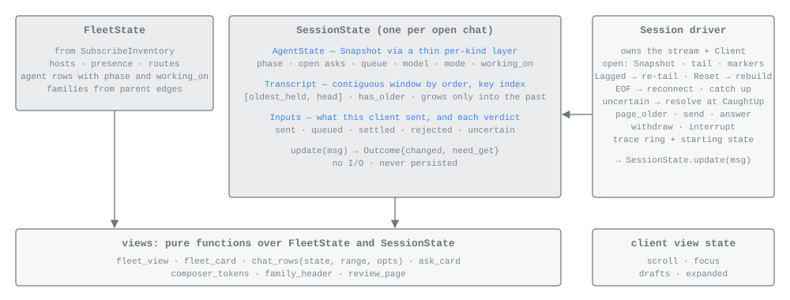
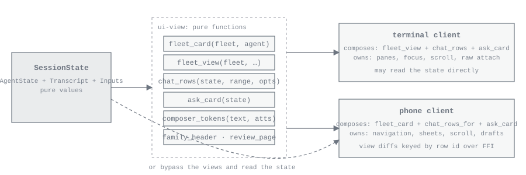

# The client library

*For developers changing either client, or the shared crates both clients link.*

amux has two rich clients, the terminal client ([TERMINAL.md](TERMINAL.md)) and the iPhone app
([IOS.md](IOS.md)); the Mac app and the browser extension ([BROWSER.md](BROWSER.md)) link the same crates. Both are thin shells over one Rust library: a pure model of an open chat and of the fleet,
a driver that owns the streams and does every piece of I/O, and a set of views that turn the model into plain
content values. Each client composes those values in its own layout and owns only what is ephemeral: panes,
scroll position, focus, drafts and which rows are expanded. A client hands its unsent drafts to the fleet driver, which keeps them
with its own machine's daemon (`UpdateDraft`, `GetDraft`) so a draft outlives the chat and the client; they never
leave that machine. Saves to one agent go in order, the newest winning, and a chat reads its draft only after them,
so one reopened at once finds what was left in it. A deleted
agent's draft goes with it: the daemon forgets it when the agent is deleted (its children too) or removed by
retention, here or on the host that ran it, and the terminal client saves nothing for a chat that closed because
its agent was deleted.

Three rules shape the library:

- **A client talks only to its local runtime.** It calls the services of the profile on its own machine: it reads
  from that node's copy of the fleet, and addresses every act to the host that owns the agent, which the node
  carries there unread. A client never opens a store, never dials another host, never holds a cursor, and never
  reads disk.
- **Per-kind knowledge lives in one thin layer.** The model knows an agent's kind (terminal Claude, headless
  Claude, Codex, an ACP agent) only where it decodes a snapshot or item body, or builds the input in a kind's
  arm. Everything above that works on kind-neutral facts; the views read the decoded bodies to produce typed rows
  and cards. What an agent can do is its `AgentCapabilities` (on its snapshot, else its host's
  `ProviderOnHost`), and how a provider is named, started and signed in to is that host's `ProviderDescriptor`
  ([the wire](WIRE.md#capabilities)); a client never decides either by matching a kind or a provider id.
  `just client-kind-check` holds the client crates to this: it lists every place in them that still matches a
  kind or a provider's name, each with why, and fails on any other.
- **Nothing is persisted.** Every value the model holds can be re-served by the runtime, so the model is never
  saved, checkpointed or restored. Closing a chat narrows its session to the few rows the fleet keeps, or drops it
  for an exited agent; opening it again pages or rebuilds the rest from the runtime's rows.

## The crates

| Crate | What it owns |
|---|---|
| [`client`](../crates/client/src/lib.rs) | The client library every client calls its node through: the generated stubs, over the profile socket on the desktop or in memory on the phone, sorted by who answers. |
| [`ui-state`](../crates/ui-state/src/lib.rs) | `SessionState` (one open chat) and `FleetState` (the inventory), updated by messages. No I/O, no clock, no handles. Also the plain shared values ([`model.rs`](../crates/ui-state/src/model.rs)): `Key`, `AgentKey`, `Attention`, `Connection`, `BlobStatus`, `Composer`, `Waiting`, `JobStop`, `PhaseView`, `Activity`, `InputState`, from which the Swift mirrors are generated. |
| [`ui-view`](../crates/ui-view/src/lib.rs) | Pure functions from the state to content values: chat rows, the ask card, the composer and overview, the settings view, fleet rows and cards, the review page, and onboarding's: which step opens, which comes next and how many are left to finish. |
| [`ui-runtime`](../crates/ui-runtime/src/lib.rs) | The drivers, `Session` and `Fleet`: subscribe, reconnect, page, send, fetch blobs, and keep a bounded trace for reports. The fleet holds the one session each live agent has. The only place a chat does I/O. |
| [`replay-support`](../crates/replay-support/src/lib.rs) | Replaying a report's records through the daemon core and the session state. |
| [`redaction`](../crates/redaction/src/lib.rs) | The structural redactor for free text and JSON in our logs and in provider recordings. |

The terminal client ([`tui`](../crates/tui/src/lib.rs)) and the phone's runtime
([`app-runtime`](../crates/app-runtime/src/lib.rs)) sit on top. The dependency policy
(`scripts/check-dependency-policy.py`, run by `just dependency-policy`) holds the shape: `client`,
`ui-state`, `ui-view`, `ui-runtime`, `tui` and `app-runtime` may not link the daemon (`node`), its `store`, the
interpreters (`interpret`), the agent process (`agent`) or any provider crate, directly or through another crate.
Among amux's own crates, `ui-state` links only `wire`; `ui-view` adds `attachments`; `ui-runtime`
adds `client` and `ui-view`, whose fleet line decides when a session wakes home.

Every value the views return for drawing derives `Serialize` and `JsonSchema`. The phone receives them as JSON over the C
bridge, and its Swift types are generated from the Rust definitions (`cargo run -p ios-tools -- swift-types`), so
there is one definition of each. [EMBEDDED.md](EMBEDDED.md) covers the bridge.

## The client seam

[`client::Client`](../crates/client/src/lib.rs) is attached to one node, over the profile's socket
(`Client::connect(path, surface)`) or called in memory (`Client::in_memory(service, surface)`, the phone's
runtime, whose entry routes and carries a call as a socket's does). Both ride the same generated stubs, so a
call reads the same either way. What it offers is sorted by who answers:

- **Local services**, answered from the node's own copy of the fleet: `inventory()` (the fleet, names resolved),
  `sessions()` (the conversations this node holds), `drafts()` (what this machine's person has typed and not
  sent) and `admin()` (the profile's administration).
- **Host services**, answered by the host that owns what they act on: `host(id)` (what it offers, pinning a
  folder, making an agent there) and `agent(row)` (every act on one agent, addressed to its host with its id
  taken from the same row). There is no other way to build a host service's stub, so no call is made without
  saying which host. The node passes a call addressed to another host on to it unread.

Every call names the client it is (`Surface`), which the node counts and the owning host records as where the
act came from. The socket's channel redials on the next call after the connection drops, so a client outlives a
daemon restart; an open stream ends and its reader subscribes again. Streams come back as `EventStream<T>`, a
boxed stream of `Result<T, RpcError>`.

The installation has its own, [`client::Installation`](../crates/client/src/installation.rs): the
`InstallationService` calls (listing, streaming, creating, binding, renaming and deleting profiles, the
daemon-run sign-in and its answer, the everyday settings, the onboarding steps and their answers, repository
suggestions and a one-time web sign-in link), over the front door (`<root>/amux.sock`) or called in memory where
the installation runs in the client's own process, and `open_profile`, which hands back a `Client` of that
profile's node. A client manages profiles the same way whichever runtime it has.

`RpcError` has two cases, and the difference matters for inputs:

| Case | Meaning |
|---|---|
| `Transport(String)` | The runtime could not be reached, or the connection failed before the answer. Whether the call took effect is unknown. |
| `Refused(wire::Error)` | The runtime answered with an error, a `google.rpc.Status`; `code()` returns its gRPC code and `reason()` the amux reason its `ErrorInfo` names, if any. |

A gRPC status that carries the runtime's error in its details is that error. A failure with no status from
the server (the connection could not be made, or broke under the call) is a transport failure, and so is a
server saying it is unavailable, as a stopping profile does. Any other status the server sent without the details
keeps its own code and words.

## Session state



[`SessionState`](../crates/ui-state/src/session.rs) is one open chat. It is built from the agent's inventory
entry and the window's cap with `SessionState::new(agent, cap)` and changes only through `update(msg)`. Its
parts:

- **The entry and host.** The agent's inventory row (lifecycle, phase, incarnation, exit cause and its detail)
  and its host's entry, both fed from the fleet.
- **`AgentState`**, the newest snapshot decoded. [`body.rs`](../crates/ui-state/src/body.rs) is the thin
  per-kind layer: `decode_snapshot` reads a `ClaudeSnapshot` (either Claude kind) or a `CodexSnapshot` into one
  shape (phase, queue, working-on, open asks, model and its display name, effort, mode, sandbox, the
  catalogue's hash, tasks, context, usage, tool servers, sign-in, background jobs, running calls). The offered
  models and commands come from the catalogue the snapshot names. The driver reads it as a blob, `GetBlob` with the
  agent and the hash the snapshot names, only while a chat shows the session, never for a session held for a
  fleet row, and keeps every catalogue it fetched under the hash it asked for, for the fleet's sessions, so each
  version is fetched once; it reaches the state as `Msg::Catalogue` with that hash. A fetch that failed, as one
  does while the agent's host cannot be reached, is asked again when the stream says `CaughtUp` or the chat is
  opened again, not at every event in between. Fetches can answer out of order, so the state never replaces a held catalogue the newest
  snapshot names with one it does not name; any other catalogue is kept as it arrives. A field the provider has not
  reported stays at its explicit unknown. Open asks keep the provider's own shape as `OpenAsk::Claude`,
  `OpenAsk::Codex` or `OpenAsk::Acp`.
- **`Transcript`**, the window of items by order, and the rows that arrived above it while the reader was in
  history. See [the transcript window](#the-transcript-window).
- **Whether the reader follows** the newest row, as the client last said. It is the one fact about the view the
  state is told, because the window's rules depend on it.
- **`Inputs`**, what this client sent during this open and what became of each input. Only the sender can know
  this, so it is the one thing the state holds that is not in the runtime's rows.
- **Connection flags**: `caught_up`, whether the stream is detached, and the `Connection` to the local runtime
  (`Connecting`, `Live`, `Reconnecting`).
- **Blob status** for each attachment hash the driver fetched.

It holds no other view state, no rows and no effects, and it never reads a clock: anything timed takes the
caller's `now_ms`.

### Messages

The driver forwards everything as a [`Msg`](../crates/ui-state/src/session.rs):

| Message | Effect |
|---|---|
| `Event(SessionEvent)` | A Snapshot overwrites `AgentState`; an Item or Append goes into the transcript; CaughtUp, Lagged, Reset and Detached move the connection flags. |
| `Page { items, exhausted, .. }` | An older page merged under the window. A page requested before a Reset's swap is dropped. |
| `Connection(Connection)` | The driver's connection to the runtime. `Reconnecting` clears `caught_up`. |
| `Send(Input)` | This client is sending an input; its optimistic row exists from now. |
| `Sent(id, InputOutcome)` | The verdict (`Reply(SendInputResponse)`), or `Lost` when the transport failed first. |
| `Discard(id)` | The person dropped an input that was not confirmed. |
| `Entry(Agent)` / `Host(HostEntry)` | The agent's inventory row and its host, from the fleet. |
| `Blob { hash, status }` | An attachment's bytes changed state in the driver's cache. |
| `Following(bool)` | The reader left the newest row (`false`) or returned to it (`true`). A session starts following. |
| `Reloading` | The driver reopened the stream for the reload a return asked for; a fresh tail follows. |

`update` returns an `Outcome`: `changed` lists every row key whose row may differ (including every member of a
run whose attributes moved, and nothing else), `need_get` names an Append to a held item at another revision than its base,
`reloaded` says a Reset's or a reload's transcript was swapped in, `session` says something outside the rows
moved, and `reload` asks the driver to reopen the stream with a fresh tail.

### The transcript window

A [`Transcript`](../crates/ui-state/src/transcript.rs) is a contiguous window: every item the client holds with
order in `[oldest_held, head]`. Each item is decoded once per revision into a `Held` (the item, its decoded
`ItemBody`, and its kind-neutral `ItemClass`). The rules:

- An item above the head appends. Inside the window it overwrites the held item with the same key only if its
  revision is higher, and is otherwise ignored; that absorbs the overlap between the runtime's store read and its broadcast.
  An item below `oldest_held` is dropped, because a page brings the current version if the reader ever scrolls
  there.
- Pages only extend the low edge.
- While the reader follows, the window keeps the newest rows up to its cap and drops older rows from its top as
  live rows arrive, so a chat left open under a flood holds a bounded set. The dropped rows' key, input-id
  and run entries go with them, a later revision of a dropped key is ignored like any row below the
  window, and the run at the new low edge reads `open_below`. The rows stay in the runtime's store and come back
  only by paging from the low edge.
- While the reader is in history, nothing is dropped and the window's head does not move. A row above the head
  is held by the session apart from the window; revisions and appends to rows inside the window still apply,
  and appends to a held row apply to it. The snapshot, asks, queue and inputs stay live, and the activity line
  reads the held rows, so the composer and ask cards stay current. `arrivals_held()` reports that rows are held,
  and both clients show their new-activity affordance from it. The held rows continue the window without a gap
  and are bounded by the cap: past it, or past a gap, the session stops holding and remembers only that the
  head moved on.
- Returning to the newest row releases the held rows into the window when they are all held, and trims the
  window back to the cap, which fetches nothing; a window grown past the cap by paging with few rows held is
  released and trimmed the same way. When the head moved on instead, the return sets `reload`: the driver
  reopens the subscription with a fresh tail, the fresh window is built apart and swapped in at CaughtUp exactly
  as a Reset's is, the old window stays on screen until then, and the swap reports `reloaded`.
- Nothing is paged downward, and no live row lands outside the window except into the held rows.
- `has_older()` is true while the oldest held order is above 1 and neither a page came back exhausted nor the
  window was trimmed since. Orders start at one and are dense, so a window that reaches order one has everything.
- The window also indexes items by input id (a prompt's reflection).

**Runs.** A run is two or more consecutive held tool items whose class says they only looked (a read, search,
listing, fetch or web search, each by its verb). [`RunIndex`](../crates/ui-state/src/transcript.rs) keeps run
membership current on every message rather than rediscovering it per frame: an item at the head extends the
last run in place; a change inside the window rebuilds only the runs around it. `RunIndex::rebuild` is the
oracle the incremental upkeep is tested against. A run whose oldest member is the oldest held item while older
history exists is `open_below`: it may continue below the window.

A call's class, including the verb a look is drawn with, is a per-kind fact the interpreter sets from native
tool kinds, never a text rule in a view; once it is set, run detection and the rows are kind-independent. So is
a Claude call's input: the interpreter reads Claude's JSON once into a `ToolInput`, which names what the call is
about (its file, pattern, address, command line) and has an arm for each tool a view draws its own way (a
shell command, a file edit or write with its replacements, a subagent, task-list bookkeeping, a web fetch or
search), with Claude's JSON kept only for any other tool. A finished edit carries the hunks Claude reported. No
view parses a call's JSON or matches on its tool's name.

### Reading the state

The state answers the questions every client asks, so no client re-derives them:

| Method | Answer |
|---|---|
| `can_send()` | Caught up, the entry does not say exited, and the agent is not a provider subagent. Drafting is never gated. |
| `composer()` | `Send`; `Resume` for an exited agent that can be resumed (`capabilities().resumable`; the draft becomes the next incarnation's first prompt), `Ended` for one that cannot (no text box, and a fresh conversation is never passed off as a resume); `Waiting(Waiting)` with `CatchingUp`, `Detached` or `Reconnecting`: the chat is not current, so nothing sends and the draft stays in the composer; or `Native { stop }` for a provider subagent (see below). |
| `native()`, `native_stop()` | Whether the agent is a subagent its parent's provider runs (`Agent.native`), and its Stop: a `JobStop` from its own job in its snapshot's background jobs, the one of kind `SUBAGENT` keyed by the provider's id for it. Offered while listed and not stopping, `Stopping` once a stop went, `Refused` with the provider's words, and `Unavailable` once it ended, when it is not listed, and always on terminal Claude. |
| `phase()` | `PhaseView`: lifecycle from the entry, everything else from the snapshot. |
| `open_asks()` | The asks to draw, head first. Before CaughtUp an ask is drawn only if the entry says needs-you, so an ask answered on another device does not flash from a cached snapshot and vanish. |
| `activity(now_ms)` | The activity line, derived from the newest items and the phase (see [the chat vocabulary](CHAT_VOCABULARY.md)). |
| `queue()` | The agent's shared queue, each entry marked `mine` and `steered`. An entry this client holds as uncertain is drawn once, as not confirmed, instead. |
| `sending()`, `not_confirmed()` | This client's prompts in flight, and those whose connection dropped before a verdict. |
| `answering(ask_key)` | This client's newest answer to an ask, while its card shows it. |
| `oldest_order()` | The page-older cursor. |

The rule for which stream to believe is by owner. For what the agent is doing (phase, open asks, queue, model,
mode) the chat believes the snapshot, the interpreter's own state. For whether the process exists it believes
the entry's lifecycle, a daemon fact: a clean exit ends with a boundary item, but a killed agent writes nothing,
and only the daemon sees its lock released.

### Inputs

Each input this client sends becomes a `SentInput` with an `InputState`:

| State | Meaning |
|---|---|
| `Sent` | In flight, or accepted and waiting for its reflection. The optimistic row exists. |
| `Queued` | Accepted into the agent's queue; every snapshot lists it until it is submitted or withdrawn. |
| `Settled` | Accepted and, for a prompt, reflected by an item carrying its input id. |
| `Rejected(refusal)` | The verdict was a rejection: a `Refusal` holding the typed reason and the provider's own words when it gave any. A rejection never touches the transcript. |
| `Uncertain` | The connection dropped before a reply. |

An uncertain input is resolved only at the next CaughtUp: found in the snapshot's queue it is queued; found among
the items it is settled; found in neither it stays uncertain and the person decides to resend or discard it.
Nothing uncertain is resent automatically: it may have reached the agent (handed to the provider and not yet
reflected looks the same as never arrived), and agents do not drop a person's input sent twice.

Nothing is ever sent later on the client's own initiative. While the chat is not current a client sends
nothing: the words stay in the composer, whose top edge says why, and the daemon-kept draft keeps them as it
keeps anything typed. A send the daemon refuses with `REFUSAL_HOST_UNREACHABLE` never left either: it is
`Rejected` like any other refusal, its words go back to the composer, and the composer says the host is away;
it goes when the person sends it again. A rejection with the refusal `REFUSAL_EXITED`
flips the composer to Resume for that incarnation, so a send that raced the exit keeps its draft.

### The fleet state

[`FleetState`](../crates/ui-state/src/fleet.rs) is the inventory: hosts by id, agent rows by `AgentKey` (host
and agent id, since a parent may live on another host), and `Families` derived from parent edges. `update`
takes a `FleetMsg` (an `InventoryEvent` or a `Connection`) and returns the agent keys whose card or family
attention may differ, including every ancestor whose family ranking may move. `attention(agent)` ranks a row
`Exited < Idle < Starting < Working < NeedsYou`, and a family is as loud as its loudest member
(`family_attention`). A child whose parent is removed heads its own family until the parent returns.

After a reconnect the fleet re-lists: rows not listed again by the next CaughtUp are dropped. Agent rows stay
small (phase, since-when, git facts); what an agent is saying or running comes from its session, which the fleet
driver keeps open for every live agent (see [the fleet](#the-fleet)).

## The drivers

[`Session`](../crates/ui-runtime/src/session.rs) owns one agent's Subscribe stream and its `Client` handle and
feeds everything into a `SessionState` behind a mutex. It is the only place a chat does I/O. Clients get
sessions from the fleet, which holds exactly one per agent, so home and a chat on the same agent read the same
state and the agent is subscribed to once.

```rust
let fleet = Fleet::connect(client, SystemClock).await?;
let session = fleet.open(&agent, Window { tail: 40, cap: 200 }).await?;
let state = session.state();          // a guard; never hold it across an await
let mut changed = session.changed();  // level-triggered watch channel
// ...
fleet.close(&agent);                  // the chat left the screen
```

`Session::open(client, agent, tail, cap, clock)`, which the fleet calls, subscribes with `tail` rows and resolves
once the Snapshot and the rows the runtime already holds are applied, up to the first CaughtUp or Detached marker
already in hand. The first render is therefore correct at once: from the runtime's own rows for an agent on this
host, and from its replica for another host's agent even while that host is away. CaughtUp may follow later.

| Method | What it does |
|---|---|
| `state()` | A `StateGuard` dereferencing to `SessionState`. |
| `changed()` | A `watch::Receiver<()>` marked on every change. |
| `take_changes()` | `Changes { keys, reloaded, session }` since the last take, each key once: what a retained list needs to reconfigure only changed cells. |
| `set_entry(agent)`, `set_host(host)` | Feed the chat its inventory row and host from the fleet. |
| `page_older(n)` | Fetch up to `n` rows older than the oldest held; see [paging](#paging). |
| `send(input)`, `send_prompt(text, attachments)` | Send under a fresh input id; returns `Sent { id, outcome }`. |
| `resume_with(draft)` | ResumeAgent with the draft as the next incarnation's first prompt; on failure the draft is discarded from the state and handed back to the composer. |
| `withdraw(queued)`, `send_now(queued)` | Take a queued prompt back, or steer it into the running turn; send-now is refused at once for an agent whose capabilities say it does not take a prompt into a running turn. |
| `answer(input)` | Answer an ask with the input `ui_view::answer_input` built. Any open ask can be answered. |
| `interrupt()` | Interrupt the turn; the agent stays live and idle. |
| `switch_back()` | Takes terminal Claude's own view back to the agent's conversation after it switched to another. |
| `rename(name)` | amux's rename: an unreachable host fails it at once with its reason. |
| `discard(id)` | Forget an input that was not confirmed. |
| `blob(hash)`, `fetch_blob(hash)`, `put_blob(name, mime, bytes)` | Attachment bytes; see [attachments](#attachments). |
| `reviews()` | The agent's review (`ui_runtime::review::Review`), for its review page: `open` (a person's look, which may begin the review or take a snapshot), `read` (read-only, what following the row and sending use), file bodies of one `Comparison` (from, snapshot, view, and for since-last the base each side was shown against, so one comparison always answers the same) fetched in batches of `BATCH_FILES` (16), a comparison's file list, more context, edits all or none, a sent review's `round` (its whole diff, every file open and fetched, found by the comments the message sent at the revisions the agent took them), and `follow(row)`, handed each row whose `RowMark` (review id, counter, moved) changed: a new review or counter reads the review again read-only, a tree that only moved marks the page stale. What it fetched is kept by request in a process-wide cache (`ReviewCache`, 32 MiB), so a review already loaded reads with the host asleep, and apart from it for as long as the open page shows it, so the page never loses what it draws. |
| `ended()` | Set when the runtime refuses to serve the chat again, as when the agent was deleted. |
| `suspended()` | Whether the stream is dropped because the phone left the foreground. |
| `trace()`, `history()`, `record()` | The bounded trace, the same as wire values, and that with nothing anybody wrote: the form a report carries it in. |
| `close()` | Drops the stream. Nothing is flushed; results of calls still in flight change nothing. |

The acts that wait on the agent return `InputError::Rejected(refusal)` or `InputError::Uncertain` when they do
not take effect. `page_older` returns `PageError::OriginUnreachable` when older history is held only by the
agent's host and that host cannot be reached; the chat says so rather than showing an empty page.

**The pump.** A background task reads the stream. `Lagged` means the runtime closed the stream because this
client fell behind: the pump reopens it with a tail at once. Any other end of the stream marks the connection
`Reconnecting`, waits (250 ms, doubling to at most 5 s, back to 250 ms once a stream catches up; see
`RECONNECT_FIRST_MS` and `RECONNECT_MAX_MS`), and subscribes again with the same tail. A refusal that is not a
transport failure ends the session (`ended()`). An Append to a held item at another revision is answered with a
`GetItem` for that key before the next event is applied, so later appends meet it. The origin's presence is not the
driver's concern: Detached and CaughtUp on the stream say whether the chat is current, and the runtime's source
reconnects to the origin on its own.

[`Fleet`](../crates/ui-runtime/src/fleet.rs) is the same shape one level up: `Fleet::connect(client, clock)`
subscribes to the inventory and resolves once it has caught up (or once the stream ended first, in which case
the pump reconnects). Its pump treats the inventory as the session's treats a chat: after `Lagged` it subscribes
again at once, without reading as `Reconnecting`, and drops what the fresh listing no longer names at its
`CaughtUp`; any other end reconnects with the same backoff. `take_changed()` returns the agent keys that moved and `take_hosts_changed()` whether any
host did. It also holds the sessions:

| Method | What it does |
|---|---|
| `session(agent)` | The live agent's session, held off screen with `HELD_ROWS` (16) rows; `None` for an exited agent no chat shows, or while the session is still opening. |
| `open(agent, window)` | The same session widened to a chat's `Window { tail, cap }`: older rows page in from the local runtime up to the tail. An exited agent's session opens here. |
| `close(agent)` | The chat left the screen. The last close narrows a live agent's session back to its few rows and drops an exited agent's. Every `open` is paired with a `close`. |
| `set_foreground(foreground)` | The phone leaving or returning to the foreground: every session's stream is dropped, or reopened with a tail. |
| `sessions()` | Every session held. |
| `on_screen_records()` | The record of every chat on screen, which a report carries. |
| `stop(agent)` | A person's stop, addressed to the agent's host. One whose host cannot be reached (`UNAVAILABLE`, or reason `HOST_UNREACHABLE` or `PAYMENT_REQUIRED`: the node sent nothing) never left: it is held, `FleetState::stop_held` and the card's `stop_held` say so, and it goes the next time the agent's host is listed online, the failed call counting as the host away even while its row still read online (as when this client's own daemon restarts). `Stop::Held` says it was held. Rename and delete are never held. |
| `cancel_stop(agent)` | Takes a held stop back. |

**The trace.** Each driver keeps a bounded trace (between 200 and `TRACE_EVENTS` = 400 events, memory only) of
every message it applied and every act of its own (`DriverEvent`: subscribed, stream ended, backoff, re-tail,
page requested, Get, blob fetch), together with a clone of the state taken when the trace's oldest segment
began. `DriverTrace::replay()` rebuilds the final state from that start, which is what makes a report replayable
rather than only inspectable: the order this client saw things in is the one thing the runtime's rows cannot
reproduce. `history()` is that trace as wire values (`wire.ClientSessionHistory`): the start state with the rows
its window held and every value the session model keeps, each message, and each driver act as it describes itself.
`SessionState::to_wire` and `from_wire`, and the same pair on `Msg`, convert both ways, and every index over the
rows is rebuilt on the way back, so a replay starts where the client stood. A client hands its open chats'
histories to the daemon inside the dump call, and the daemon redacts each through its agent's kind and writes it
into the bundle under `client/sessions/<agent id>/` before the bundle is complete. When a transcript fails its
check, the trace is taken under the same lock as the failing message, so the dump ends at it. The fleet writes
only the structure of its state and trace (`client/fleet/state.txt`, `trace.txt`), never names, paths or status
text. See [DEBUGGING.md](DEBUGGING.md).

## Views



Every function in [`ui-view`](../crates/ui-view/src/lib.rs) takes a `SessionState` or `FleetState` plus explicit
arguments (an order range, a set of keys, an option struct, an expansion set) and returns a value. No view takes
a size, a width or a theme. Views carry typed facts; wording, wrapping, geometry, colour and animation belong to
each renderer.

A view decides; a client presents. Any judgement both clients must agree on (whether an agent needs you, how a
session ended, why a prompt was refused, what a model is called, how a setting can change, which settings the
composer mentions, what a new agent's pickers hold and what a pick there does, where a tool call stands, what a plan's
title is, which lines an edit changes, whether a form's answers can go and what they send) is computed once in a view and handed over as a
typed value, never as text: each client words it. Where a client's own choice changes what a view returns, such
as folding tool steps, the client passes the choice in as an argument. A client may read plain facts from the state
directly (a name, a path, a count the state holds), but never works out a judgement from them.

| Function | Returns |
|---|---|
| `chat_rows(state, range, opts)` | One `Row` per held item whose order is in `range`, widened to include any run that crosses either edge. The terminal's call, for what is on screen. |
| `chat_rows_for(state, keys, opts)` | Rows for these keys, in order. The phone's call, for the cells an update changed. |
| `ask_card(state)` | The head ask as an `AskCard`, with its count, or `None`. |
| `answer_input(card, answer, note)`, `question_answer(card, responses)`, `reply_answer(card, words, responses)` | The input that answers the card in its kind's arm; a question's response carries its picks and its typed "Something else" words together; the person's own words instead of an answer, on a question that takes them or on any ask whose card says `reply_instead`. |
| `act_input(kind, act)`, `create_config(kind, provider, chosen)` | The input for a prompt, withdraw, send-now, interrupt, job stop or switch-back in the kind's arm (None for an act the kind has no input for), and a new agent's create arm for the kind its host starts the picked provider as. The runtimes and the browser bridge build their inputs here, so no client holds a kind arm of its own. |
| `form_problems(fields, values)`, `form_answer(card, values)` | A tool server's form, checked and encoded once for every client: given one `FormValue` per field (typed text, a toggle, a choice or picks by position), each field's `FieldProblem` (required and empty, not a number or not a whole one, out of the schema's range, too short or long, too few or many picked), or the Submit carrying the JSON object the schema describes. |
| `composer(state, now_ms)`, `waiting(state)`, `switched_away(state)` | The composer mode, the activity line inside it, and whether terminal Claude's own view is on another conversation (prompts are refused until `Session::switch_back` takes it back); the waiting reason. |
| `composer_tokens(draft, attachments)`, `segments(text, attachments)` | Text runs and attachment chips at their placeholder positions. |
| `queue_rows(state)`, `sends_to_feed(state)`, `prompts_underway(state, in_feed)`, `refused_prompts(state)` | Queued prompts (withdraw, and send now only where the agent's capabilities say `sends_now`); whether a new prompt lands at the feed's end or in the queue; this client's prompts on their way, each where it was first drawn, sending or may not have arrived; the prompts the agent refused, with why. |
| `overview(state, changed)`, `changes(changed)`, `Comparison::base()`, `lists_changes(state)` | The `Overview`: tasks, background jobs (each with its `JobStop`: unavailable where the agent's capabilities say it stops no one job, or for a job with no key, offered with its key, stopping, or refused with the provider's words), failed tool servers, usage near a limit, and the changed files by folder (root files first, renames with their old path) as the agent's host answered `GetChanges`, with the base it used; what a comparison asks for: HEAD, or nothing for the host's own rule on the branch. |
| `context(state)`, `sign_in(state)` | Context use (near full from 80%) and a sign-in problem, with the provider's name and its host's words for signing in (the descriptor's `sign_in_hint`, which may mark commands in backticks). |
| `untaken(state, attachments)`, `untaken_file(state, mime)` | The first attachment the agent's capabilities say it does not take (`Untaken::Images` or `Files`), so a client refuses it before storing the file; pasted text and page comments always go. |
| `settings(state)`, `setting_input(kind, change)` | What the agent offers to change (models, efforts, permissions, modes, commands), each choice named and its current one marked; how each setting changes (`Changeable`: a pick, the agent's own cycle, typing its own command, or not offered); and the input a pick sends. |
| `controls(state)` | The `ControlsSummary` beside the composer: the running model by its one name, the effort in force, and the permission and mode only while they are not the agent's normal ones. |
| `new_agent_settings(catalogue, chosen)`, `new_agent_pick(catalogue, chosen, pick)` | A new agent's settings from its host's catalogue, in the settings view's own choices (what can be set at start, the chosen ones marked, the normal mode in force when none is chosen, a chosen value the host does not list kept); and what is chosen after a pick: another model starts at its default effort and gives up a permission it does not take for the normal one, and picking the normal mode leaves the mode unchosen. |
| `fleet_view(fleet, local_host, lines, expand, keep)`, `session_line(state, now_ms)` | Home's sections (needs you, live, exited) with each family in its loudest member's section, newest since-when first, whether each starts folded, and every row's second line; the fleet-wide counts of agents that need you and that are working; what one session knows for that line. |
| `fleet_card(fleet, local_host, agent_id)`, `family_header(fleet, local_host, agent_id)` | One agent's card (name, branch, host and its reach, how it ended, family counts, whether it is a provider subagent, its provider id and the name its host's descriptor gives it, else the name `wire::agents::display_name` knows the id by (Claude, Codex, a built-in ACP agent), else the id, and whether it can be attached in its own terminal, from its host's entry when that entry's kind matches the agent's, else what its kind can do), and a chat's family header with how many of the family need you. |
| `opened_agent(fleet, agent_id)`, `group_state(fleet, agents)`, `chat_agents(state, fleet)` | The agent a call row opens as its fleet row has it (its key to open, its title else its name, its kind, its `PhaseView`), or None when the fleet does not hold it; what a group's agents come to (`GroupState`: running, needing you, idle, finished, ended, failed, unknown); and every agent a chat's held rows open with each group's state, which the phone is handed when the fleet moves. |
| `toggle_group(state, member, open)`, `subagent_rows_moved(state, changed)` | Opens or closes the group a call belongs to, in the set that holds open runs; and the calls whose group a change moved without touching them (a call joining, a turn bound, a cut taking the first), for a client holding rows by key. |
| `reach(fleet, local_host, host)` | How this machine reaches a host: online over a route; away, meaning only that the relay refused it for the account's free plan and upgrading reaches it; or offline, for a reason this machine can name (this machine is signed out, or the host no longer trusts it) or for none. |
| `review_page(summary, files, context, state)`, `anchor(page, from, to)`, `review_chip(agent)` | The review page as rows (file heads, hunk heads, lines with their changed words, gaps that load more context, comments where they are placed), banners and the files still to fetch, from the summary and bodies the agent's host answered and the person's choices; the commit and lines a selection of rows comments on; and the composer's chip from the review's entry on the agent's row while it holds drafts. |
| `patch_head(state, key, max)` | The first lines of an edit's patch. |

A few facts exist so that a client can say what happened without reading further: an edit's ask says whether it
`created` the file (so it reads "Wants to create"); a plan's row carries its `verdict` (approved, approved switching to
the permission it names from then on, sent back) and `writing` (the plan still streaming in); pasted text's chip carries the `text` itself, so
a sent message can show what was pasted in place of the chip; a command's row keeps its `output_tail` beside its
head, for a step opened to show how it ended; and a background command's row its `duration_ms` once it has ended.

**Rows are items.** `chat_rows` emits exactly one [`Row`](../crates/ui-view/src/rows.rs) per item, and the row id
is always the item key. A `Row` carries its `kind` (a `RowKind`), its `run` (a `Run`, when it is in one), a
`collapsed` flag the client skips, the permission `decision` drawn on a tool call's own row, `attention` (an open
ask points at it, or it failed), `opens` and `group` for a call that opens an agent (below), and a `parent` for
a subagent's own step from history, which collapses under the subagent's row. The row kinds and what each draws
are in [CHAT_VOCABULARY.md](CHAT_VOCABULARY.md).

**Calls open their agents.** A call that started or continues an agent names it in `opens`, by its id: Claude's
Agent call and a SendMessage continuing it (`ToolCall.child_agent_id`), a Codex spawn or follow-up of a child
thread (`CollabWork.agent_ids`), and amux's own spawn from either (`ToolCall.child_agent_id`,
`McpToolCall.child_agent_id`). Every client opens that agent's chat from the row (a tap on the phone and the Mac,
the leader's open on the focused row in the terminal), a gesture apart from expanding the row. How the agent
stands (running, waiting on you, done, stopped) is never the call's: a call can return while its subagent runs
on, and only the fleet row knows of an ask the subagent waits on. A client reads it from the fleet it already
holds, with `opened_agent`. The row carries only the reference, so rows still change only with their items. A call from before amux knew the agent
opens nothing and reads its own state. Such a call is not a step: it ends a run rather than folding into one, and
`Hide` does not hide it. Codex's calls on children that start none (waiting on, closing, interrupting, listing
them) draw nothing.

**Groups are attributes.** The calls of one turn that opened more than one agent fold into one row, "4 subagents ·
2 running · 1 waiting on you": each carries `group` (`SubagentGroup`: its `first` held call, each agent it opened
once, in order, and whether it is `open`). Folded, the first call draws the group's row, from `group_state` over
its agents, and the rest are `collapsed`; open, each call draws its own row under it. A client holds a group open
by any of its calls, in the same set that holds open runs: `toggle_group` holds its newest call, which no trim at
the low edge takes first. `ShowAll` and `Hide` draw every group open. A call joining a group, a turn bound
splitting one, and a cut taking a group's first call change rows the change does not touch;
`subagent_rows_moved` names them, and the phone's runtime adds them to every delta.

**Runs are attributes.** There is one fold for tool steps: a run is every tool step between two pieces of what
the agent or the person put in the transcript. Thinking, retry notices, a subagent's own steps from history and
items that draw nothing pass through a run; an ask, the agent's text, a prompt, a turn's end or a call that opens
an agent ends it. The session's run index
keeps membership current on every message (and marks every member changed when its run moves), and `Run` on each
member row says it: the run's `first` held step (where an opened run draws its header), its `last` step,
`steps`, `live` (nothing has ended it yet), `open_below`, `recent` (for one of its two newest steps, how many
follow), `live_shown` (live, and this step is its newest or still running), `hidden` (on the oldest step a live
run shows, what the steps it does not show did, for the line above it), `unresolved_failure` (this step failed,
its turn has ended and nothing later in the turn with the same subject succeeded) and, on the newest step's row
only, `counts` of what its steps did, each file read or changed counted once. `ChatOptions { tools }`
chooses `ShowAll`, `Hide` (every step hidden but an unresolved failure) or `Collapse { open }`: a run folds to its
newest step, where a client draws its one line, keeping an unresolved failure; while live it shows its newest
step and any step still running, so calls made side by side all show; a run `open` holds any step of shows every
step. When a page merges older steps into a run, the
newest step the reader is looking at keeps its id and the run grows its count; when a live step extends a run, the
newest step moves to it, where nothing is anchored.

A run's ends move with the window, so neither names it: a page merges older steps in below, and a window following
the newest row trims its oldest steps. A client therefore holds an open run by one of its steps, and a run is open
when the client's set holds any member (`run_is_open`, a lookup per held key, never a walk of the run).
`toggle_run` opens a run by holding its newest step, which no page moves, and closes it by forgetting every member the
set holds; `keep_open_runs` moves each hold to its run's current newest step, so a client that calls it as rows
arrive keeps a growing run open while the window trims it. What the client holds survives both merges and trims, and
a hold whose step left the window opens the run again when it pages back in.

`Turns { runs, turns }` reads each finished turn answer first, for a desktop: the turn's prompt carries the line over
its work (`Worked`: how long, whether it failed), its work folds under that line, and the answer — the turn's last
stretch of the agent's text — and the turn's end stay drawn, the end carrying the answer's rows and each file the turn
changed once, its edits summed. An error, a boundary, a compaction and an unresolved failure stay in view whatever the
fold. Every row of a finished turn carries `TurnPlace` (the turn's `end`, `open`, and its `part`), and `collapsed` is
decided from it, so the client draws what it is handed. A turn is held open by its end's key in `turns`, which never
moves; inside an opened turn and in the turn under way, runs fold as `Collapse` folds them. A turn draws unfolded
until the window holds the prompt or steer that opened it, when a steer cut it short, and when it was stopped.

A row's place in its turn depends on rows a change does not touch: a turn's end moves every row of the turn, a prompt
paging in folds the turn after it, and a cut at the low edge unfolds the turn that lost its prompt. `turn_rows_moved`
names those rows for a set of changed keys; the phone's runtime adds them to a chat's delta only while the chat folds
turns (`amux_session_fold_turns`), so a client folding runs sends nothing extra. Folding turns on the phone and in the
terminal was left for later: the line under each prompt reads well on a desktop's width first.

Three guarantees follow, and any list technique, including the inverted list chat apps use, can rely on them:
row ids never move; the window changes only at its two edges; appends touch only items still open.

## Flows


### Opening a chat

`Fleet::open` widens the agent's session to a tail: 40 rows in the terminal (`PAGE` in
`crates/tui/src/chat/layout.rs`), 200 on the phone (`DEFAULT_TAIL` in `app-runtime`). A live agent's session is
already open with its few rows, and the rest of the tail pages in below them from the local runtime; an exited
agent's opens with the whole tail. Either way the Snapshot and the newest rows come from the runtime's own rows,
so the first render is correct at once. CaughtUp follows at once
if the runtime's source for that agent is current, or after the delta if it is catching up; live events follow.

- The header always paints from the inventory entry and host presence.
- The composer takes a draft at any time. While the chat is not current (before CaughtUp, after Detached, or
  reconnecting to the runtime) the composer is `Waiting`: Send sends nothing, the draft stays where it is, and
  the composer's edge says why; once the chat catches up the same Send sends it.
- An agent with no rows yet arrives as a Snapshot with no items. The client shows a loading hint after 300 ms
  (`LOADING_HINT_MS` in the terminal, `loadingHintDelay` on the phone) until the tail lands.
- Losing the host mid-chat arrives as Detached: the header changes, sending waits, the rows stay. When the
  runtime's source reconnects, the delta or a Reset follows under the same rules; the client does nothing.
- A deleted agent's session reports `ended()`, and the client closes it to the fleet. The fleet is home: no
  client reopens a chat on its own.
- A provider subagent's chat (Claude's Agent tool, a Codex child thread; `Agent.native` is set) opens like any
  other, from its fleet row under its parent or from the call row in its parent's chat that opens it. Its
  composer is `Native { stop }`: no text box, only that Claude or Codex runs this subagent and it takes no
  messages, and the Stop `stop` offers, which sends `StopJob { key }` to the subagent's own id. Its asks are
  answered as any ask is, to its id; the daemon passes answers and stops to the process that runs it and refuses
  the rest. Nothing keyed on a folder, a terminal or a composer applies to it: `settings` offers nothing to pick
  and no command, `lists_changes` is false (its files are its parent's), the runtime fetches no catalogue and keeps no
  draft for it, terminal attach refuses it, and its fleet card says `native`, so no client offers it a resume, a
  delete, a pin or a terminal. Its overview leaves out its own job, which the composer stops.

### Sending

`send_prompt` puts the text and attachments in the kind's prompt input (`ui_view::act_input`), refuses it at
once when it carries an attachment the agent does not take (recorded as a refused prompt, so its words and
attachments go back to the composer like any refusal's), gives it a fresh input id, applies `Msg::Send` so the optimistic row exists at once, and calls `SendInput`. The reply is the
interpreter's verdict: accepted (possibly `queued`), or rejected with a reason. A prompt sent while a turn runs
waits in the agent's queue, which every snapshot lists, so other clients see it too; `queue_rows` offers
withdraw and send-now on it, and send-now steers it into the running turn, where it reads "steered" until its
reflection lands. `stop_job` sends the kind's `StopJob` for a background job's key, only where the agent's
capabilities say `stops_job`; the job's `JobStop` says how it stands from then on.

This client's own prompts on their way are one rule for every client. `sends_to_feed` says where a new prompt
lands: at the feed's end while the agent is idle with nothing queued, otherwise in the queue. The client
remembers that place, and `prompts_underway` draws each prompt there until the agent's queue or transcript
holds it, so it does not jump as the agent starts work. A prompt the connection dropped, which catching up
found neither queued nor in the transcript, reads "may not have arrived" with resend and discard.
`refused_prompts` lists the ones the agent or its host refused; the words go back to the composer with the
reason, which for a host that could not be reached is that the host is away.

When the entry says exited, the composer is `Resume` where the agent can be resumed: the draft goes through
`resume_with` as the next incarnation's first prompt, one tap. An ACP agent that offered no way to reopen a
session is `Ended` instead.

### The client's own commands

Some commands are the client's, the same on every client, and never reach the agent: `/model` and `/effort` (bare,
they open amux's picker; with a value, they set it through the kind's typed input) and `/rename` (amux's rename).
`settings(state).commands` lists them first, `/model` only with two models to choose between and `/effort` only
with two efforts, and a provider command of the same name gives way to them (headless Claude lists all three
itself). `slash(state, text)` says what a typed draft is: `Prompt` (send it as typed; Claude runs its own commands
from the text), `Pick`, `Set(input)`, `Rename(name)`, `Typed(text)` (terminal Claude takes no model or effort
input, so the pick is typed as Claude's own `/model <value>`), `Unknown` for a value the agent does not offer, and
`Refused` for a command Codex does not run: Codex runs only the commands amux implements for it, and any other `/…`
would reach its model as words; for a skill's name `hint` carries the `$name` mention to type. Only a first word of
a slash and a name is a command, so a path is words. Each `CommandView` says how it is typed: `sigil` is `/` for a
command and `$` for a Codex skill, and `anywhere` marks a skill, which may be mentioned anywhere in a message
rather than only at its start. Claude lists its skills among its commands, as Claude reports them. The phone's runtime runs the same rule through `Chat::command`, which answers a `CommandOutcome`.

### Answering an ask

`ask_card` builds the card for the head ask. Each `Choice` carries its `ChoiceOutcome` and the answer body it
sends; the client passes the chosen answer (with a note, for choices that take one) to `answer_input`, then to
`Session::answer`. An ACP agent's permission ask offers exactly the options the agent sent, the ones amux has no
outcome for as `ChoiceOutcome::Offered` with the agent's name for them; its own forms and links are named as the
agent; and every ACP ask takes the person's words instead (`reply_instead`), which a refusal's or a decline's note
becomes. A form's values go to `form_answer` instead, which refuses them with each field's problem or
builds the Submit; both clients say what keeps a form back from the same `form_problems`. An answer names its ask by key, so any queued ask can be answered from any client. While the
answer is in flight the card's `CardState` is `Sending`; a rejection brings it back as `Rejected(refusal)`; a lost
connection leaves it `NotConfirmed` with resend and discard; an exited agent's asks are `Dismissed`. On the phone,
answers never carry a provider's answer body across the bridge: the phone names a choice by position, gives one
`Pick` per question, or gives a form one `FormValue` per field, and the answer is built in Rust.

### Attachments

To attach bytes, the client calls `put_blob(name, mime, bytes)`, which stores them in the agent's directory on
its host and returns a `BlobRef` (hash, name, mime, size). A prompt on the wire is text with one placeholder
character (U+FFFC, `attachments::PLACEHOLDER`) per attachment and the attachments in order; `composer_tokens` and
`segments` split it into text runs and chips. The phone's bridge takes a `Draft` instead, an ordered list of
word runs and attachments, and writes the placeholders itself, so a draft cannot carry an attachment without
its place.

Rows that show an attachment draw a placeholder from the reference's name, type and size. The first
`Session::blob(hash)` for a missing hash starts a `GetBlob`; when the bytes land (or fail), `Msg::Blob` marks
every row referencing that hash as changed, and the rows redraw. Bytes are cached for the life of the session
only. [ATTACHMENTS.md](ATTACHMENTS.md) covers blobs, sent reviews and delivery to providers.

### The fleet

`Fleet::connect` subscribes to the inventory; `FleetState` holds hosts, agent rows with their phase,
since-when and git facts, and families. `fleet_view` puts each family in the section of its loudest member
(needs you, running, exited) and orders families by since-when, newest first, with expanded families' members
beneath their parents. Since-when moves only when an agent's state does, so rows never move while an agent
streams. A folded family whose head does not need the person carries the member that does.

Each row's second line goes by the state the inventory row says, in words its session supplies: the snapshot's
notice, the same one a push says, when it needs you; the step it is running (the chat's activity line, with the
step's command or file) when working, and while it waits on its subagents, how those its chat opened that are still
live stand (`ActivityLine.subagents`, filled by `fleet_view` from the fleet as `ChatAgents.live` is), so that once one
of them waits on the person the row says so in the group's words, as the chat does; when idle, what stops it (signed out, a spent usage window, a failed turn),
also from the notice, or else the first line of what it last said, its markdown read as words; nothing while starting or before its session opens; how it ended once exited,
whatever its host is doing; or that its host no longer trusts this machine (`HostRevoked`), which only pairing
again undoes. A host out of reach otherwise changes nothing in the line: the row says what this machine last held,
and each client marks the host's reach from the card's `host_reach`. The header's working and needs-you
counts leave out agents whose host is out of reach, as their rows do. Names reach the row without direction
controls, so a right-to-left override cannot make one read as something else. How an agent ended is typed from the row's `ExitCause`
(`ui_state::exit_cause`): finished for `FINISHED`; ended for a stop, for `UNSPECIFIED` and for a cause this build
does not know, since unknown is not failure; failed for every other cause, carrying the cause's words followed by
its own ("the provider exited: exit code 1"), as on the chat's phase. What an agent is working on is how agents find each
other and is not shown.
A client reads each session with `session_line` on its own, then the fleet, so it never holds both at once.

The fleet keeps one live session per live agent, and it is the only session that agent has: home reads it for the
row's second line, and a chat on the agent reads the same one, so one agent never has two subscriptions.

- **Off screen** a session holds `HELD_ROWS` (16) rows while its reader follows, enough for what the agent last
  said or the step it is running, and gathers no changes for a list. Opening a chat widens it and pages older
  rows in from the local runtime; closing the chat narrows it again.
- **An exited agent has no session** until a chat opens it, and loses it when that chat closes. An agent that
  exits while no chat shows it loses its session at once; one going live again gets a new one.
- **Home is woken by what changes its line.** A session's rows streaming in redraw its chat, and wake home only
  when they change the line home draws for the agent (`session_line`): a new running step, the step ending, what
  the agent last said. Rows that leave that line as it was never wake home, and a step's age moving is not a
  change; a client redraws home on a wake, never on a tick. A snapshot (which is how a turn ending arrives), the
  queue or the stream's markers wake it too. A wake marks the agent changed in `take_changed()` and fires the
  fleet's change signal.
- **The foreground.** `set_foreground(false)` drops every session's stream, an open chat's included, leaving
  its rows and reading as reconnecting; `set_foreground(true)` reopens each with a tail at once and starts
  sessions for agents that went live meanwhile.

The fleet feeds each session its entry and host (`set_entry`, `set_host`) whenever the inventory moves them,
which is how the chat's header and its exited rule stay current. The two streams can disagree for one round trip, and the ownership rule above decides who wins:
the entry on lifecycle, the snapshot on everything else.

### Streaming

The interpreter streams a reply as Appends: a key, the base revision it extends, the revision it produces, and
text. The transcript applies an Append only when the held item's revision equals its base; an Append the held
revision already covers is stale and ignored; a held item at any other revision returns `need_get`, and the
driver fetches the full item with `GetItem`. An Append for a key the session holds nothing for is dropped. Appends
are only ever sent live, after CaughtUp, so their base is what the client holds. The final full item closes the
stream: a `Prose` row reads `streaming: false` once its item is complete.

Dropping is safe because an item always reaches the stream before its first Append. A session that holds
nothing for a key has let that item go: it is below the window (a session off screen keeps only a few rows), or
it arrived while the reader was away and was released for the reload. The row comes back whole from the store
the next time it is read, by a page or the reload. Fetching it instead would cost a `GetItem` per running item below
the window, and with appends going to any open item, a long command below a small window would fetch on every
chunk of its output.

### Paging

`page_older(n)` sends `ListItems { before_order: oldest_order, page_size: n }` and applies the response as `Msg::Page`.
Rows merge downward below the window, keep their ids, and never land above the head; a page that comes back
`exhausted` rules out older history and clears the `open_below` mark of the run at the low edge. Scrolling back
down fetches nothing: in history the window only grows, and the rows paged in stay.

Paging is the client's decision, never the model's: a client pages when fewer than a page of held rows sits
above the top of the screen and `has_older()` is true. While the reader follows, `page_older` fetches only what
fits under the cap (`SessionState::page_room`) and nothing once the window is full, so a following client never
fetches rows the next live row would trim. When the top visible row is a collapsed run marked
`open_below`, it asks for a larger page, up to a cap (1000 rows, `RUN_PAGE_CAP` in the terminal and
`largestPage` on the phone), so a run of two thousand calls costs a few round trips rather than fifty.

### Resets and reconnects

A Reset means the origin's history changed under the chat (a rewind, for example). The state keeps the rows on
screen and builds a fresh transcript from the events that follow; at the next CaughtUp it swaps the fresh one in
and reports `reloaded`, one of the two times a client reloads its whole list; the other is the reload of a head
that moved on while the reader was in history. A re-tail after a reconnect whose rows do not meet the held
window is handled the same way while the reader follows; in history it only marks the head as moved on. So is a
re-tail whose `Opening` names another generation than the window was built under, since the gap may have
carried a Reset. The window is built under the generation of the stream's first `Opening` and then of each
Reset, which names the block it brings, so a re-tail after a Reset the stream carried continues the window; and a transcript being built apart starts over when the stream reopens, the re-tail being its
whole. Detached
clears `caught_up`; the rows stay.

## The two draw loops

Both clients make the same three moves: when the change signal fires, ask for rows; keep the model a page ahead
of the screen; own the view state. Each redraws on change and never on a clock. The change signal is a
level-triggered `watch` channel, so every change that lands during a draw collapses into the next one: a flood of
records costs whatever draw rate the machine sustains, and each frame shows the latest state.

**The terminal is immediate mode.** [`tui::run`](../crates/tui/src/run.rs) waits in one `select!` on a key, the
fleet's change signal, the open chat's change signal, a finished task, or a tick. Ticks are scheduled only while
something on screen moves with time: every 250 ms while the agent works (the activity line's elapsed time) or the
chat is still empty, and at the end of the quit guard or a notice. Each frame,
[`chat/layout.rs`](../crates/tui/src/chat/layout.rs) lays rows out from the anchor (a row key and line offset, or
pinned to the bottom) at the known width until the feed is full, so heights are exact before anything is painted
and the cost is the visible rows; ratatui then writes only the cells that differ. An item outside a run asks
`chat_rows` for its own order; a run member asks `chat_rows_for` by key, and collapsed members are skipped before
any row is built. When fewer than `LOOKAHEAD` (40) held rows sit above the screen and older history exists,
layout asks for a page, no larger than the room under the cap while the reader follows. After every key, mouse
event and frame the app tells the session whether the anchor is pinned to the bottom, and the "new activity"
line under a scrolled-back feed reads `arrivals_held()`.

**The phone is retained mode.** [`app-runtime`](../crates/app-runtime/src/chat.rs) watches each open chat's session's
change signal and gathers `take_changes()` into a coalescer that wakes the host once per turn, however many updates
land. On the host's step it hands over one `ChatDelta` per chat that moved, computed against what it last handed
over: the keys at their edges (new above the newest held, a page below the oldest, and how many of the oldest a
following window dropped) or, after a reload, all of them; the rows of the keys it held that changed; and the frame, the head ask, the overview, the settings and the agents the rows open (`chat_agents`) only when they moved, the frame not for the clock
alone. A chat also watches the fleet while its rows open agents, since the fleet moving changes how they stand
and no row; a group is opened and closed with `Chat::toggle_group` (`amux_session_toggle_group`). The Swift `ChatModel` applies each delta and reads a row by key only when its cell is first drawn or after a
reload, so a streaming append costs one cell and nothing is read back on the main thread. The fleet is handed over
the same way, as a `FleetDelta`. The top of the list coming into view asks for an older page. `AppRuntime::set_foreground` hands the app's foreground to the fleet, and dropping a `Chat` closes it to
the fleet. `ChatModel.following` is told to the session with `follow(_:)` whenever it changes, and New activity shows
from the frame's `arrivals_held`. [IOS.md](IOS.md) and
[EMBEDDED.md](EMBEDDED.md) cover the phone side.

The edges are computed once, in Rust, and the phone only applies them.
[`app-runtime/src/schedules.rs`](../crates/app-runtime/src/schedules.rs) walks seeded schedules of the client model
(`models::client`) and, at every cut, applies the delta to a copy of the host's keys and holds it equal to the
session's window, with a row handed over for every changed key the host held and none for a key new at an edge.

## Replay and redaction

[`replay-support`](../crates/replay-support/src/lib.rs) replays reports.
[`bundle.rs`](../crates/replay-support/src/bundle.rs) opens a bundle the daemon wrote: the daemon core's record,
each agent's record and each chat's record. `Bundle::replay_all` (in `replay.rs`, and `just repro`) replays each
agent's record as a made-up stream through its interpreter, the core from its checkpoint and each chat's record
through `SessionState`, with the properties judged at every step; see [Debugging](DEBUGGING.md#replaying-a-report). `record::replays_alike` holds a chat's record to
replaying as its whole history does.
Recorded provider traffic (the recording manifests, sanitizing and the capture plumbing both probes share) is the
live lane's, in `qualification::recording`.

[`redaction`](../crates/redaction/src/lib.rs) masks what is left of free text: `redact_value` for JSON and
`redact_text` for text replace secrets, machine paths, emails and the local user and host with fixed placeholders
and count what they replaced in a `RedactionSummary`. Our logs in a report and the provider recordings
qualification commits go through it; a report's records carry no text to mask.

## Tests

| Where | What it holds | Run |
|---|---|---|
| `crates/ui-state/tests/spec/` | The session and fleet model: window rules, runs against `RunIndex::rebuild`, inputs and uncertainty, asks before CaughtUp, the activity line, opening, snapshots, the fleet, and properties: arrival-order independence, and catch-up plus live equal to uninterrupted delivery at every cut. | `just suite client-model-spec` |
| `crates/ui-view/tests/` | View goldens replayed from every interpreter fixture of all three kinds (`goldens.rs`), authored goldens, row invariants over random windows (`views.rs`), and the interpreter accepting each card's answers (`answers.rs`). Rewrite goldens with `UI_VIEW_UPDATE_GOLDENS=1` and review the diff. | `just test-crate ui-view` |
| `crates/ui-runtime/tests/` | The drivers against an in-memory runtime whose every answer and clock tick the test controls (opening, reconnect and re-tail, uncertain inputs, paging, blobs, traces and dump parts), and against a real daemon in process running an agent on a fake provider, through both clients. | `just test-crate ui-runtime` |
| `crates/client/tests/seam.rs` | Both `Client` implementations answer alike against one real daemon. | `just test-crate client` |
| `crates/replay-support/tests/` | Reports a test net writes, replayed through the core and session stages and printed by the dump printer. | `just test-crate replay-support` |

[TESTING.md](TESTING.md) places these in the suite catalogue.
