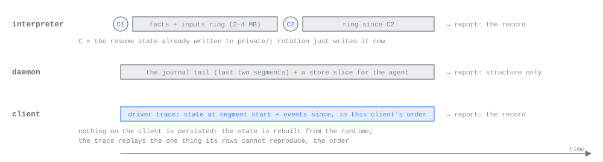

# Debugging

*For anyone, person or agent, working out why amux did something wrong: start here.*

amux is built so that a wrong row on a screen can be traced back to the step that went wrong without anybody's
words leaving the machine. Each process keeps a bounded record of what it was fed, each stage between provider and
screen is a pure function that can be replayed from that record, and one command gathers what those stages
concluded into one directory: a report. This page says where things are on disk, what a report holds, where it goes,
and how to narrow a problem to one stage.

## Where to look first

1. **Save a report while the problem is visible.** `amux dump --reason "what looks wrong"` prints the bundle's
   directory. The bounded records it is built from roll over as the agents keep working.
2. **Read the bundle's `manifest.json`.** Its `errors` list says what could not be gathered (an agent process that
   did not answer, a record past the size limit), so a missing file is never a mystery.
3. **Replay it.** `dump-replay` steps the daemon core and each chat on screen through their records and names the
   step that broke ([replaying a report](#replaying-a-report)).
4. **Read the logs** for the moment it happened: the report carries the daemon's, the supervisor's and each agent's
   last minute; on the machine itself there is also the provider's `private/provider.log`, which no report carries.
5. **Turn it into a test** at the boundary you found, before fixing it (see [Testing](TESTING.md)).

## Where things are

Every file amux keeps is in [the one on-disk listing](ARCHITECTURE.md#everything-else-on-disk), with the agent
directory [just before it](ARCHITECTURE.md#the-agent-directory-is-the-contract). For debugging, the installation
root (`<root>`, normally `~/.local/share/amux`) holds `daemon.log`, `supervisor.log` when amux runs under one, and
`reports/`; each agent's directory, `profiles/<profile id>/agents/<agent id>/`, holds `agent.log` and its
`private/provider.log`.

Every log is capped the same way: past its cap its contents move to `<name>.1`, replacing the previous one, and
the file starts again from empty, so a log and its `.1` are all there is. The caps are 8 MiB for `daemon.log`,
`supervisor.log` and the phone's log, and 1 MiB each for `agent.log` and `provider.log`. The move copies and
truncates in place rather than renaming, so a process's standard error and a provider's, which other handles hold,
keep landing in the live file; the daemon and the supervisor also move their own standard error onto their log, so
a panic is in it. On the phone the embedded runtime keeps the same layout inside the app's container; its log is
`runtime.log`.

What the agent directory is and who writes what is described in [the agent process](AGENT_PROCESS.md); the
journal and the store in [Journal and store](JOURNAL_AND_STORE.md).

## What each process keeps



**The agent process** records every event it feeds its interpreter in the facts ring, `private/facts/`, before
stepping: provider output, inputs, agent messages, ticks, the provider's exit, the daemon going away, stop requests.
Each line is one JSON object:

```json
{"event":"tick","at_ms":1790524769870}
{"event":"fact","channel":"stream","text":"{\"type\":\"assistant\", …}"}
{"event":"input","hex":"0a10…"}
{"event":"agent_message","hex":"0a10…"}
```

Provider payloads are text (hex only if a payload is not UTF-8); inputs and agent messages are their encoded protobuf
in hex. The ring
is two segments named by byte offset, like the journal. A segment rotates when it reaches half the ring's size
(`agent.facts_ring_mib` in the installation config, 4 MiB by default), and the oldest is deleted. Rotation writes a
checkpoint beside the new segment: the interpreter's whole state, as JSON, before the segment's first entry. That
checkpoint is not extra machinery: it is exactly what a resume starts from (the newest checkpoint with its
segment's entries fed through the interpreter again), and so it is also what a replay starts from. Each
incarnation starts a new segment from the state it resumed.

For terminal Claude and Codex the provider's own transcript is also a complete record of what it said; the ring
adds what that transcript lacks (hooks, inputs, ticks). For headless Claude the ring is the only record.

**The daemon** keeps each agent's journal and its rows in the store. Each profile's core takes a checkpoint a
minute after any step that changed a row: its state, serialized once the store's WAL is in its main file. Its
driver records every input the core steps in `core-ring/` beside the store, and starts the ring afresh at each
checkpoint, which heads the segment, so the checkpoint and the ring together are the core's state now. The daemon keeps
every agent's journal from the newest checkpoint's cursor on, and at least the last two segments, so a report's core
record always has every frame the recorded inputs read.

**A client** keeps, in memory only, a driver trace per open chat and for the fleet: the session state as it stood
when the trace's older segment began, then every message and driver event since (subscribed, stream ended,
reopened with a tail, backoff, page, get, blob) in the order this client saw them. It holds between 200 and 400
events. The order is the one thing the store's rows cannot reproduce, which is why the trace exists. Nothing on a
client is persisted or checkpointed: its state is rebuilt from the runtime's rows.

## What a report holds

Every report holds the same parts, whatever asked for it: a person (`amux dump`, the terminal's report, the
phone's Report a Problem or Export Diagnostics) or one of amux's own checks. What asked is only a label, the
manifest's `trigger`: `person`, or the check's id. The parts are records, which say what each stage concluded and
never what anybody wrote: no message, prompt, tool input or output, file name, folder, branch or host name.

- **The daemon core's record**: its newest checkpoint, every input it stepped since and the store as of that
  checkpoint, as their structure alone (see [the core's record](#the-daemon-cores-record)), with each own agent's
  journal from the checkpoint's cursor on, its frames the same way.
- **Each own agent's record**, built by its process when the report is made (see [the agent's
  record](#the-agents-record)). An agent another host runs has its record in a report taken there.
- **The record of each chat the asking client shows** (see [a session's record](#a-sessions-record)), and the
  fleet's structure. `amux dump` from a terminal shows no chat, so it carries none. A chat whose transcript fails
  its own check includes its record, cut at the message that failed.
- **Our own logs**: the daemon's, the supervisor's when amux runs under one, and each own agent's `agent.log`, each
  with its `.1` for the minute before the report, at INFO and above, at most 1 MiB of each, with secrets, machine
  paths, email addresses and this machine's user and host names masked. The provider's own log never goes.
- **For a person's report**, the note, the marks they drew and the frozen screen, beside the bundle (see [a report
  from the terminal](#a-report-from-the-terminal) and [from the phone](#a-report-from-the-phone)).

Each record is held to 64 KiB once compressed: one past it is left out, and the manifest names its size under
`over_limit` and says why in `errors`. For the core, that says to checkpoint more often rather than to send more.

```text
reports/dump-<unix ms>-<id>/
  manifest.json                 dump id, time, trigger, reason (masked), profile, host, generation,
                                daemon version, one entry per own agent, the client's sessions, the
                                core's counts, and errors
  daemon.log                    the daemon's log and its .1 for the minute before, at INFO and above
  supervisor.log                the same of the supervisor's, when amux runs under one
  core/checkpoint               the daemon core's newest checkpoint
  core/inputs                   every input the core stepped since, and how far each ingest read
                                an agent's journal, one JSON line each
  core/store.sqlite             the profile's store as of that checkpoint
  core/journals/<agent id>/<segment>
                                each own agent's journal from the segment holding the checkpoint's
                                cursor on
  agents/<agent id>/record      each own agent's record (JSON)
  agents/<agent id>/agent.log   its own log for the minute before
  client/sessions/<agent id>/   each chat the asking client shows, as its record:
    checkpoint                  its state when its trace began (a wire.ClientSession)
    events                      every event its driver saw since, through the one that broke it when
                                one did (a wire.ClientSessionEvents)
  client/fleet/state.txt        the fleet's part: the structure of its state and its driver trace,
  client/fleet/trace.txt        with no names, paths or message text
```

The bundle is assembled under a dotted name beside its final one and renamed into place when complete, so a
directory without a leading dot is whole. Each agent's manifest entry names its kind, lifecycle and incarnation and
whether its record is there. Protobuf files are encoded without a length prefix; journal segments keep the
journal's own framing and every frame keeps its length, so an offset in the store or in `core/inputs` names the same
frame in the bundle. A frame still being written when the report was taken keeps only its length prefix.

The core's record reveals no pairing opened after the report: it carries the PIN or secret of a pairing open at the
time and the randomness that pairing draws from, and every window or pairing conversation opens with fresh
randomness the bundle never holds.

## Saving and sending a report

A report goes one of two ways, and is the same bundle either way:

- **Saved**: `amux dump` writes it into the installation's `reports/` and prints its directory; the phone's
  **Export Diagnostics**, under Help, writes it into the app runtime's `reports/` and hands that directory to the
  share sheet, so it can be AirDropped or saved to Files.
- **Sent** to the account the profile is signed in to (see [sending reports](#sending-reports)): `amux dump --send`,
  a person's report from the terminal or the phone, and a check's report when automatic reports are on. What is
  sent is the saved bundle packed as one file, and a copy stays in `reports/`.

```sh
amux dump --reason "the reviewer's last answer never appeared"
amux dump --send
amux --profile Work dump
```

## Reports nobody asks for

When the daemon's core breaks one of its cheap invariants, or a step runs over its budget, the daemon writes a
report whose `reason` starts `the daemon core: `. A chat whose transcript fails its own check when the stream catches
up or resets asks for one too, with the reason starting `the client's transcript: ` and that chat's record inside, its
trace cut at the message the check failed at. An agent process whose core breaks one of its invariants, or whose
interpreter breaks one of its own checks, or that takes a step over its budget, says so on its stderr (`the agent
core: `) and asks its daemon for a report over the control connection, sending its [record](#the-agents-record),
built then, with the ask; the daemon writes the report, reason starting `an agent's core: ` and naming the agent,
with that record, which it writes even when the agent has exited since. Every interpreter is judged by the same checks
after every step, whatever its kind: every tool result answers a call the interpreter saw
(`agent.tool_result_without_call`), the provider's exit leaves no turn open and no item streaming
(`agent.exit_left_open`), an ask that closed is never answered later (`agent.closed_ask_answered`), and every item
key is opened before it is updated or closed, and never reopened (`agent.item_before_open`).
Every check has a stable id, its core's name and its own (`daemon.generation_fell`, `agent.taken_still_pending`,
`transcript.window`; a step over budget is `<core>.over_budget`), which is the manifest's `trigger`. The relay, the
path machine and the supervisor log the same kind of reason (`the relay core: `, `the supervisor core: `), and the
relay and the supervisor write a text file beside it: the reason, the core's state when the driver's window began,
every input stepped since (at least the last 256) and the state now. The supervisor writes
`<data_dir>/reports/supervisor-<unix ms>-<id>.txt`; a relay writes `relay-<unix ms>-<id>.txt` into `reports/` under its
`state_dir` (see [running the relay](CLOUD.md#running-the-relay)), and a daemon's own relay core into the
installation's `reports/`. Neither core is a replay stage and nothing replays these files: they are what a person
turns into a step test of that core by hand. Each process reports one per kind of reason (one per broken invariant,
one for steps over budget) every ten minutes, and the daemon writes one agent-asked report per kind in the same
interval, however many agents ask; the next one of that kind says how many were held back since. Every core times its
steps against a budget of its own: the daemon's 100 ms, the relay's 1 ms, and the agent's and the supervisor's 10 ms.

Each check a limit admits is also counted as a `check_failed` usage event, naming the core, the check's id, whether
it was an invariant or a step over budget, and how many the limit held back since: no reason text and nothing from
the report (see [what amux sends](ANALYTICS.md)). It is sent whenever usage events are, so a check that breaks in
the field is seen without anybody sending its report.

## Records

A record is built when a report is made, from what each process already keeps, and holds what a stage concluded
rather than what anybody wrote.

### The daemon core's record

The daemon core reads no content: it acts on ids, kinds, order, sizes and time. So its record is its checkpoint,
inputs, store copy and the journals it reads with every value treated by the name of the field that holds it, from
one table in `crates/redaction/src/structure.rs`, and it still restores and replays as the original does:

- Bodies and free text (prompts, agent output, error text, item and snapshot bodies, kept blobs and patches)
  become zero bytes of their length, so every size and offset holds. Text that is only whitespace is kept, as the
  core treats it as empty. A pairing refusal's words are blanked too: the core tells refusals apart by their code
  and typed reason, which are kept.
- Identifiers the core compares (host and agent names, folders, branches, SSH destinations, accounts, tokens) become
  aliases such as `host-1` and `path-3`, the same value the same alias throughout the record. A name ending in a
  number keeps it on its stem's alias (`name-1-2`), and a name the core assigns itself from its word pairs
  (`quiet-otter`) is kept, as the core compares the names it assigns with those it holds.
- Ids, item keys, counts, revisions, error codes, timings, versions and settings (model, effort, permission mode)
  are kept, as are network addresses, which the core parses and dials, and public keys, which it compares.
- The core's randomness is kept, so a replay mints every id the live core did; and so is everything a pairing in
  the window exchanged, whose values the core checks against what it derives from that randomness and the window's
  secret. Such a pairing's secret and the peer it paired with can be read from the bundle.

The store copy is rewritten in place and rebuilt, so nothing replaced stays in a free page. A journal frame whose
aliases changed its length is written to its original length, without its texts where it no longer fits.

### A session's record

A chat's rows reach a client already interpreted, so its session can be recorded as what the session model concludes
rather than what anybody wrote. A record is the session's history with every body emptied to its arm (prompt,
message, tool call, ask and so on) and the few fields the model reads from it: whether a message, thinking or
reasoning block is complete; a tool call's state, its parent's key, whether its subagent finished and whether its
input is a task list; an error's retry, attempt, limit and retry time; headless Claude's status; whether Codex's
safety check runs; and the kind of Codex's work. A snapshot keeps its envelope (phase, queue by input id, times,
catalogue hash) and of its body the open asks' keys, terminal Claude's announced calls by id and time, headless
Claude's tasks by id and state, and whether its view switched away. A row keeps its key, order, revision, kind,
input id, time and attachment hashes; an input its arm and the ask key or queued input it names; the agent and host
their ids, kind and states. Every text, name, path and an agent's own words for a refusal or an exit are emptied,
and each event keeps the size it had. The driver's own acts are kept as they are: they name keys, counts and the
kind of each error it met (its code and amux reason), never an error's words, which may be another host's. A record is marked
`structure_only`, and the daemon writes nothing else of a chat into a report.

A record replays through the same session model to the same windows, runs, inputs, activity and failed checks as the
whole history: `replay_support::record::replays_alike` replays both and names the first message after which they
differ, which would be a body field the model reads and the record leaves out. The replay-support suite holds every
interpreter fixture's session to that, healthy and with a row skipped, and a real node's chat in the ui-runtime
suite too. What a record cannot show is how the rows were drawn: wrapping, glyph widths and markdown depend on the
text, and a person's screenshot shows them.

### The agent's record

An agent's record is built only when a report is made, from the facts ring the agent already keeps: the agent process
runs the ring's events through its own interpreter again, from each segment's checkpoint, on the machine that wrote
them, and keeps what the interpreter concluded, never what was said: no string or JSON value, nothing anyone said or
any tool read or wrote. For each event it keeps its kind (a provider fact by the kind its protocol tags it as, with
each tool call's or result's tool name and the keys of its input or result; a person's input by its arm; an agent
message by its ids; a tick by its time) and size, and what the interpreter concluded: each item opened, updated or
closed by key and arm, appends by key and size, the snapshot's phase and queue, turn ends, its effects by kind with
their sizes and the ids they answer, what its two queries (messages pending, typed input unrecorded) answered after
the step, and the check the step broke. Each segment starts from the interpreter's open items, queue, asks and
pending inputs by key. Git facts are counts: files and lines changed, and whether there is a branch, never its name.
The record names the spec's kind, provider, model, permission, mode, effort and launch flags without their values,
and the provider's version once it reports one, and carries the agent core's lifecycle as the report found it, its
states by name and its sets by size. Ids, item keys and a tool server's own tool names and keys are aliases, hashed
with a salt that never leaves the process, so equal values stay equal within one record and none can be looked up.

The interpreter's checks come out in the record as they did live, since they judge the same steps. The agent core's
own checks and a step over budget are named by the report's reason and trigger; the core's inputs are not kept, so they
are not replayed, and the lifecycle beside the record is where to look. An interpreter's mistake is read from the
order of event kinds beside what the interpreter concluded, and a reproduction is a fixture written by hand with the
same kinds in the same order.

## Replaying a report

A report runs. `dump-replay` replays a bundle's records through their stages, in the order a row passes through
them, with the protocol's properties (the sentences the models in `crates/models` check) judged at every step, and
prints one line per stage:

```sh
cargo build -p replay-support --bins
target/debug/dump-replay reports/dump-<unix ms>-<id>
```

```text
daemon core  holds   38 inputs from the checkpoint, each step judged
session      holds   1 client session from its checkpoint, 7 messages, each judged
```

| Stage | Replays | Judged |
| --- | --- | --- |
| daemon core | the core restored from `core/checkpoint` over a copy of `core/store.sqlite`, fed every input in `core/inputs` with each journal it reads cut to where the live step found it, and a commit the live step had refused refused again | after each input: the core asks for no dump, its store keeps every invariant it checks, every row it answers is committed, and every journal read finds what the live one found (a checkpoint plus the inputs since reproduces the state) |
| session | each chat's record restored from its `checkpoint` and fed every message in its `events` | at the checkpoint and after each message: the window is one block |

A stage that fails prints `FAILS`, the step (the input counted from one, for the core; the message counted from one
after the checkpoint, for a client session, with its place in the trace), the property's sentence and what broke it,
and the command exits non-zero. A client session the manifest names whose files are missing or do not read fails
the session stage as `unreadable`, never holds. The first stage that fails is the culprit. A stage the bundle carries
nothing for prints `absent` and why: a report from the command line shows no chat. When every stage holds, the fault
is in a driver, an interpreter or presentation: the agents' records and our logs are where to look.

A report the core asked for because one of its invariants broke replays to the step that broke it, naming the
invariant. A report a chat asked for because its transcript failed its check replays that chat from its checkpoint to
the first message that left the window broken, which can come before the CaughtUp the client checked it at. Replay it
with the build that wrote it: a build with the bug fixed steps the same inputs through the fix and holds, unless the
state the checkpoint carries was already broken, in which case it fails at the same step.

An agent's record is not replayed yet: it is read beside the stages, in `dump-show`. Its events by kind, in order,
beside what the interpreter concluded of each, show an interpreter's mistake, and a reproduction is a fixture with
the same kinds in the same order.

Both tools open a report's bundle directory, a report directory (its bundle is under `dump/`), or a report's
`dump.pb.zst` as downloaded from the account service, which they unpack into a temporary directory first.
`dump-show` prints everything in a bundle as text: the manifest, each agent's record, each chat's record, the core's
record with its store's rows and journals, and every other file.

The same is a library, `replay-support` (`crates/replay-support/src/bundle.rs` and `replay.rs`):

```rust
let bundle = Bundle::open(path)?;
let verdicts = bundle.replay_all()?;            // one StageVerdict per stage, as dump-replay prints them
let failing = bundle.replay_core()?;            // the core's first failing step and its property, or None
for agent in &bundle.agents {
    let record = &agent.record;                 // the agent's record, as its process built it
}
```

The simplest way to work on a bundle is a scratch test beside `crates/replay-support/tests/core_replay.rs`, which
replays bundles the same way: a real daemon's `amux dump` on a testnet net, written at test time by the build under
test, and that bundle with a broken core checkpoint or a chat's record missing a row planted in it
(`crates/replay-support/tests/support.rs`).

### Narrowing a problem to one stage

Find the item that looks wrong by its key, then compare layer by layer:

| Compare | If they differ | The bug is in |
| --- | --- | --- |
| The agent's record: each event's kind and what the interpreter concluded of it | The interpreter decided wrong for that order of events | the interpreter: write a fixture with the same kinds in the same order in `crates/interpret/fixtures` |
| The core's replay against its record | The core stepped wrong | `daemon-core`: the failing step is the test |
| A chat's record replayed (`dump-replay`, `dump-show` prints its events) | The order the client saw explains what it drew | `ui-state` or the session driver |
| The screen against the record | The renderer drew the right rows wrong | the terminal or the phone: the person's frozen screen shows how |

On the machine itself, with nothing leaving it, the facts ring, the journal and the store hold the words too: the
provider's output in the ring, the interpreter's steps in the journal and the rows in the store, each readable by the
person whose machine it is.

## A report from the terminal

`b` on home, or the leader then `b` in a chat, freezes the screen as it was and opens a report over it; at the same
instant the client starts the report's bundle, with its own parts and the record of the chat on screen. Drag with the mouse over anything wrong to mark
it, and each mark takes a note of its own; one note covers the whole. Enter hands the report to the daemon, which
writes it into the installation's `reports/` directory and sends it to the profile's account; the terminal says it
was sent and where the copy is, or where it was kept and why it was not sent. Esc leaves without writing anything.

The bundle, `reports/report-<unix ms>-<id>/`, readable by its user only:

| File | Contents |
| --- | --- |
| `report.json` | The header (schema 1): build, time, note, marks in cells, the viewport in cells, and every part declared present or absent with a reason |
| `frame.txt` | The frozen screen as text, without the report's own panel |
| `frame.json` | The same cells with their colours and styles: each row as runs of one style from their first column, a colour as `#rrggbb`, `ansi:N` or `default` (the terminal's own ink or ground, whose values `default` records) |
| `dump/…` | The bundle, as above, with this client's fleet part and the record of the chat on screen under `client/` |

The client draws no picture itself, so as to carry no fonts: `just shot -- frame <bundle>` draws `frame.json` into
`frame.png` beside it, numbered colours in their conventional values. The client keeps no log of its own (the daemon's is in the
bundle) and records no view trace (its runtime's order of events is in the bundle's `client/` parts), and
`report.json` says so.

## A report from the phone

A phone gives up its diagnostics two ways, both under Help, as the same bundle. **Export Diagnostics** saves it, with
the app runtime's client parts and the record of the chat on screen, and hands its directory to the share sheet, so
it can be AirDropped or saved to Files and read as above. **Report a Problem** sends it to the person's amux account
with a note and the frozen screen.

Reporting a problem is in every build of the app. Taking a screenshot makes the app freeze its own composited
frame and offer to report it; Report a Problem under Help freezes the screen and opens the report directly. In the
same instant the app starts the report's bundle. The person marks rectangles on the frozen frame, writes a note
on each and one overall, and presses Send, which hands the report to the app's runtime to write beside its bundle and
send to their amux account (the account signed in on screen; with none, Send is refused and says why). A failed send
keeps everything for a retry, which sends the same report again. A person's report is never sent in the background;
a check's report is, only when **Send Automatic Reports** under **You**, in **This phone**, is on.

The bundle, in the runtime's `reports/report-<unix ms>-<id>/`, holds:

| File | Contents |
| --- | --- |
| `report.json` | Build and git revision, time, note, marks in points with the frame's size and scale, and every part declared present or absent with a reason |
| `frame.png` | The frozen screen, without the status bar |
| `dump/…` | The bundle, as above, with the fleet's structure and the record of the chat on screen from the app runtime |

## Sending reports

A report leaves a machine one way: the runtime (the daemon, or the app's embedded runtime) uploads it to the account
service of the account its profile is signed in to, as `POST /api/reports`, multipart, with the profile's bearer.
The sections are `report.json` (schema 1), the client's frame files (`frame.png`, or `frame.txt` and `frame.json`),
`trace.jsonl` where there is one, and `dump.pb.zst`: the bundle packed as one `wire.DumpPart` and compressed with
zstd, byte for byte the bundle that was saved, which the replay tools open as it is. A failure the service might not repeat (a server error, a timeout, no
answer) is tried twice more, five and then ten seconds later; after that, or after a refusal, the bundle stays in
`reports/` and the client says why. A signed-out profile sends nothing.

Three things send:

- **A person's report** from the terminal (Enter) or the phone (Send), through `ProfileAdminService.SubmitReport`:
  the client names the bundle it took and hands its `report.json` and frame files; the runtime writes them with the
  bundle into a report directory and uploads it. Naming that report directory again sends it again.
- **`amux dump --send`**, the saved bundle sent with a header of its own.
- **A check's report**, sent right after it is written when the installation's `auto_reports` setting is on
  (`amux config set auto_reports true`, read at each report; on the phone, **Send Automatic Reports**). It is off
  by default. Its `report.json` says `kind: automatic`, names the core and the check's id, and carries the masked
  reason and no frame.

What the account service does with reports is on [Cloud](CLOUD.md); the report screen itself is on [the iPhone
app](IOS.md).
